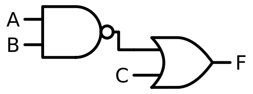
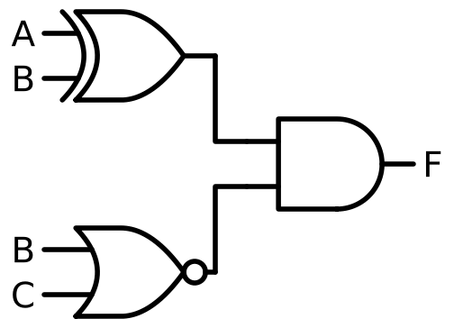
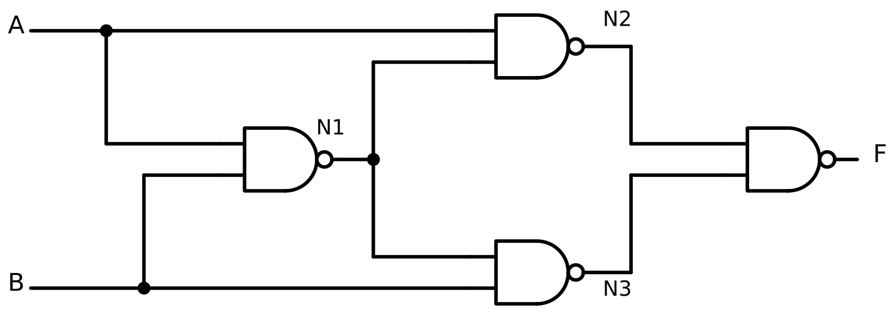
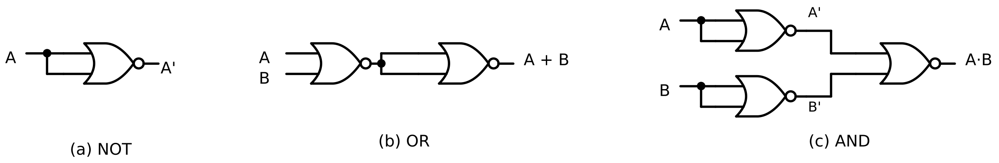
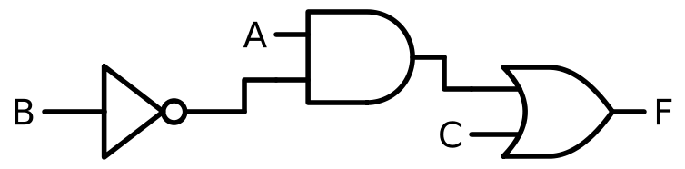
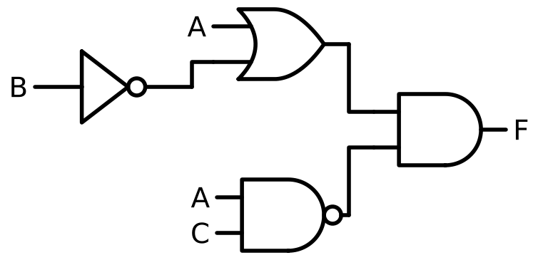

**MATERI TAMBAHAN RANGKAIAN LOGIKA**

**Latihan Subbab 3, 4, dan 5**

*Gerbang turunan, membaca dan membangun rangkaian, serta menyusun ekspresi dari tabel kebenaran*

**Cara memakai latihan ini**

Latihan ini melengkapi latihan di akhir materi. Soal dikelompokkan per subbab, dan setiap soal diberi tanda tingkat kesulitannya.

- **\[A\]** memeriksa apakah Anda ingat dan memahami isi subbab.

- **\[B\]** meminta Anda menerapkan cara yang sudah dipelajari pada soal baru.

- **\[C\]** meminta Anda menganalisis, menemukan kesalahan, atau menilai sebuah pendapat.

Kerjakan dulu semua soal satu subbab sebelum membuka kunci jawaban di bagian akhir. Untuk soal yang meminta tabel kebenaran, selalu tulis kombinasi masukan secara berurutan seperti menghitung dalam biner: 000, 001, 010, dan seterusnya. Dengan cara ini, Anda dapat mencocokkan jawaban Anda dengan kunci baris demi baris.

**Latihan Subbab 3 Gerbang turunan**

**1.** \[A\] Lengkapi tabel berikut untuk gerbang NAND dan NOR **tiga masukan**.

| **A** | **B** | **C** | **NAND (A·B·C)'** | **NOR (A + B + C)'** |
|-------|-------|-------|-------------------|----------------------|
| 0     | 0     | 0     | …                 | …                    |
| 0     | 1     | 1     | …                 | …                    |
| 1     | 1     | 0     | …                 | …                    |
| 1     | 1     | 1     | …                 | …                    |

**2.** \[A\] Sebutkan nama gerbang dua masukan yang sesuai dengan setiap uraian berikut.

a.  Keluarannya 1 hanya jika semua masukan bernilai 0.

b.  Keluarannya 0 hanya jika semua masukan bernilai 1.

c.  Keluarannya 1 jika kedua masukan bernilai sama.

d.  Keluarannya 1 jika kedua masukan bernilai berbeda.

**3.** \[A\] Dari enam gerbang dua masukan, yaitu AND, OR, NAND, NOR, XOR, dan XNOR, gerbang mana saja yang menghasilkan keluaran 1 jika:

a.  A = 1 dan B = 0?

b.  A = 1 dan B = 1?

**4.** \[B\] Buktikan dengan tabel kebenaran bahwa XNOR sama dengan XOR yang salah satu masukannya dibalik, yaitu (A ⊕ B)' = A' ⊕ B.

**5.** \[B\] Subbab 3.1 menyebutkan bahwa NOR juga merupakan gerbang universal. Tunjukkan cara membuat NOT, OR, dan AND hanya dengan gerbang NOR. Gambarkan rangkaiannya, lalu buktikan setiap rangkaian dengan tabel kebenaran.

**6.** \[B\] Rumah kos Anda punya tangga yang lebih panjang, sehingga lampunya diatur oleh tiga sakelar: A di bawah, B di tengah, dan C di atas. Aturannya sama dengan lampu tangga di awal materi: setiap kali *salah satu* sakelar dipindah, keadaan lampu berbalik. Pada awalnya, ketiga sakelar dalam posisi 0 dan lampu padam.

a.  Susun tabel kebenaran lampu L untuk delapan kombinasi sakelar.

b.  Tunjukkan bahwa L = (A ⊕ B) ⊕ C dengan menambahkan kolom bantu A ⊕ B pada tabel Anda.

c.  Nyatakan aturan lampu ini dalam satu kalimat yang memakai kata "ganjil" atau "genap".

**7.** \[C\] Seorang teman berpendapat, "NAND itu AND ditambah NOT. Jadi, NAND pasti lebih mahal daripada AND. Aneh kalau pabrik justru lebih suka membuat NAND." Nilailah pendapat itu.

*Petunjuk:* Pada teknologi CMOS, yaitu teknologi yang dipakai di hampir semua cip saat ini, gerbang NAND dua masukan dibuat dari 4 transistor. Gerbang AND dua masukan biasanya dibuat dari sebuah NAND yang keluarannya dibalik oleh gerbang NOT, dan gerbang NOT itu membutuhkan 2 transistor.

**Latihan Subbab 4 Membaca dan membangun rangkaian**

**1.** \[A\] Tulis ulang setiap ekspresi berikut dengan tanda kurung lengkap, sehingga urutan pengerjaannya terlihat jelas. Contoh: A + BC ditulis A + (B·C).

a.  A + B·C'

b.  A'B + C

c.  (A + B)'C

d.  AB' + A'B

**2.** \[A\] Hitung nilai fungsi berikut untuk masukan yang diberikan.

a.  F = A'B + AC' untuk (A, B, C) = (1, 0, 0), (0, 1, 1), (1, 1, 1), dan (0, 0, 0).

b.  G = (A + B)' + BC' untuk (A, B, C) = (1, 0, 0), (0, 0, 1), dan (1, 1, 0).

**3.** \[A\] Buatlah satu tabel kebenaran yang memuat dua kolom keluaran, yaitu A'B dan (AB)'. Pada baris mana saja kedua ekspresi itu memberi hasil yang berbeda?

**4.** \[B\] Perhatikan rangkaian pada Gambar L1.

**Gambar L1 Rangkaian untuk Soal 4**

a.  Tuliskan ekspresi F.

b.  Susun tabel kebenarannya dengan kolom bantu untuk keluaran gerbang pertama.

c.  Nyatakan dengan kata-kata kapan F bernilai 0.

**5.** \[B\] Perhatikan rangkaian pada Gambar L2. Masukan B digambar dua kali karena masuk ke dua gerbang yang berbeda, tetapi keduanya adalah sinyal yang sama.

**Gambar L2 Rangkaian untuk Soal 5**

a.  Beri nama X untuk keluaran gerbang XOR dan Y untuk keluaran gerbang NOR. Tuliskan ekspresi X, Y, dan F.

b.  Susun tabel kebenarannya dengan kolom bantu X dan Y.

c.  Rangkaian ini memakai tiga gerbang. Berapa baris yang menghasilkan F = 1? Apa yang dapat Anda simpulkan tentang ukuran rangkaian ini dibandingkan dengan pekerjaan yang sebenarnya dilakukannya?

**6.** \[B\] Gambarkan rangkaian untuk setiap ekspresi berikut. Mulailah dari gerbang paling kanan, yaitu operasi yang dikerjakan paling akhir. Sebutkan juga jumlah gerbang dari setiap jenis yang Anda pakai.

a.  F = AB' + C

b.  F = (A + B')·(AC)'

**7.** \[C\] Seorang mahasiswa diminta menggambar rangkaian untuk F = (AB)'. Ia menggambar dua gerbang NOT, satu untuk A dan satu untuk B, lalu memasukkan keduanya ke sebuah gerbang AND.

a.  Apakah rangkaiannya benar? Buktikan jawaban Anda dengan satu kombinasi masukan saja.

b.  Fungsi apa yang sebenarnya dibuat oleh rangkaian mahasiswa itu? Sebutkan nama gerbang tunggal yang perilakunya sama.

c.  Bagaimana rangkaian yang benar?

**8.** \[C\] Rangkaian pada Gambar L3 hanya memakai gerbang NAND.

**Gambar L3 Rangkaian empat gerbang NAND**

a.  Lengkapi tabel berikut.

| **A** | **B** | **N1** | **N2** | **N3** | **F** |
|-------|-------|--------|--------|--------|-------|
| 0     | 0     | …      | …      | …      | …     |
| 0     | 1     | …      | …      | …      | …     |
| 1     | 0     | …      | …      | …      | …     |
| 1     | 1     | …      | …      | …      | …     |

b.  Kolom F sama dengan gerbang apa?

c.  Gerbang itu sudah tersedia sebagai satu simbol. Mengapa seorang perancang mungkin tetap memilih membuatnya dari empat NAND?

**Latihan Subbab 5 Dari tabel kebenaran ke ekspresi**

**1.** \[A\] Untuk fungsi tiga variabel A, B, dan C, tuliskan minterm dan maxterm dari setiap baris berikut.

a.  ABC = 010

b.  ABC = 101

c.  ABC = 111

**2.** \[A\] Jawablah pertanyaan berikut.

a.  Pada fungsi tiga variabel A, B, dan C, suku apakah m6?

b.  Pada fungsi empat variabel A, B, C, dan D, suku apakah m6?

c.  Pada fungsi empat variabel, suku AB'CD adalah minterm nomor berapa?

d.  Mengapa jawaban (a) dan (b) berbeda, padahal nomornya sama?

**3.** \[B\] Diketahui tabel kebenaran berikut.

| **A** | **B** | **C** | **F** |
|-------|-------|-------|-------|
| 0     | 0     | 0     | 0     |
| 0     | 0     | 1     | 1     |
| 0     | 1     | 0     | 0     |
| 0     | 1     | 1     | 1     |
| 1     | 0     | 0     | 1     |
| 1     | 0     | 1     | 0     |
| 1     | 1     | 0     | 1     |
| 1     | 1     | 1     | 0     |

a.  Tuliskan F dalam notasi Σm.

b.  Tuliskan F dalam bentuk jumlah hasil kali kanonik.

c.  Tuliskan F dalam bentuk hasil kali jumlah kanonik.

d.  Perhatikan kolom A, kolom C, dan kolom F. Hubungan apa yang Anda lihat?

**4.** \[B\] Pintu ruang server sebuah kantor dikendalikan oleh tiga sinyal:

- K = 1 jika kartu akses yang ditempelkan sah;

- P = 1 jika PIN yang dimasukkan benar;

- S = 1 jika satpam menekan tombol izin dari pos jaga.

Aturannya: pintu terbuka jika kartu sah *dan* PIN benar atau satpam memberi izin, atau keduanya.

a.  Susun tabel kebenaran untuk sinyal pintu D, dengan urutan variabel K, P, S.

b.  Tuliskan D dalam notasi Σm dan dalam bentuk jumlah hasil kali kanonik.

c.  Aturan di atas juga dapat langsung ditulis sebagai D = K(P + S). Bandingkan jumlah gerbang yang dibutuhkan oleh bentuk kanonik dan oleh bentuk K(P + S).

**5.** \[B\] Rancanglah rangkaian yang menerima bilangan 0 sampai 7 dalam bentuk biner tiga bit ABC, dengan A sebagai bit paling kiri. Keluaran F bernilai 1 jika bilangan itu bilangan prima. Ingat bahwa 1 bukan bilangan prima.

a.  Susun tabel kebenarannya.

b.  Tuliskan F dalam notasi Σm dan dalam bentuk jumlah hasil kali kanonik.

c.  Tuliskan F dalam bentuk hasil kali jumlah kanonik.

**6.** \[B\] Panitia beranggotakan tiga orang, yaitu A, B, dan C. Sebuah lampu kuning menyala jika *tepat satu* anggota setuju. Susun tabel kebenarannya, lalu tuliskan fungsinya dalam notasi Σm dan bentuk jumlah hasil kali kanonik.

**7.** \[C\] Sebuah fungsi tiga variabel bernilai 0 hanya jika A = B = C = 1. Pada tujuh kombinasi lainnya, fungsi itu bernilai 1.

a.  Tuliskan fungsi itu dalam bentuk jumlah hasil kali kanonik. Ada berapa suku?

b.  Tuliskan fungsi itu dalam bentuk hasil kali jumlah kanonik. Ada berapa suku?

c.  Bentuk mana yang lebih hemat? Fungsi ini sebenarnya sama dengan satu gerbang apa?

d.  Rumuskan aturan umum: kapan bentuk hasil kali jumlah lebih ringkas daripada bentuk jumlah hasil kali?

**8.** \[C\] Seorang mahasiswa diberi tabel kebenaran yang bernilai 1 hanya pada baris ABC = 001 dan ABC = 100. Ia menulis jawaban F = ABC' + A'BC.

a.  Temukan kesalahannya.

b.  Tunjukkan bahwa jawabannya salah dengan menyisipkan satu baris dari tabel ke dalam ekspresinya.

c.  Tuliskan jawaban yang benar.

d.  Usulkan satu kebiasaan sederhana yang dapat mencegah kesalahan seperti ini.

**Kunci Jawaban dan Pembahasan**

**Kunci Subbab 3**

**Nomor 1.**

| **A** | **B** | **C** | **NAND** | **NOR** |
|-------|-------|-------|----------|---------|
| 0     | 0     | 0     | 1        | 1       |
| 0     | 1     | 1     | 1        | 0       |
| 1     | 1     | 0     | 1        | 0       |
| 1     | 1     | 1     | 0        | 0       |

NAND tiga masukan hanya bernilai 0 jika ketiga masukan bernilai 1. NOR tiga masukan hanya bernilai 1 jika ketiga masukan bernilai 0.

**Nomor 2.** (a) NOR. (b) NAND. (c) XNOR. (d) XOR.

**Nomor 3.**

a.  OR, NAND, dan XOR.

b.  AND, OR, dan XNOR.

Cara memeriksanya: baca baris A = 1, B = 0 dan baris A = 1, B = 1 pada Tabel 1 dan Tabel 2 di naskah.

**Nomor 4.**

| **A** | **B** | **A ⊕ B** | **(A ⊕ B)'** | **A'** | **A' ⊕ B** |
|-------|-------|-----------|--------------|--------|------------|
| 0     | 0     | 0         | 1            | 1      | 1          |
| 0     | 1     | 1         | 0            | 1      | 0          |
| 1     | 0     | 1         | 0            | 0      | 0          |
| 1     | 1     | 0         | 1            | 0      | 1          |

Kolom (A ⊕ B)' dan kolom A' ⊕ B sama pada keempat baris, sehingga kedua ekspresi terbukti sama. Alasannya mudah dipahami: membalik salah satu masukan berarti mengubah "sama" menjadi "berbeda" dan sebaliknya, sehingga keluaran XOR ikut berbalik.

**Nomor 5.** Rangkaiannya ditunjukkan pada Gambar L6.

**Gambar L6 Membuat NOT, OR, dan AND hanya dengan gerbang NOR**

- **NOT** (Gambar L6a). Hubungkan kedua masukan NOR menjadi satu. Hasilnya (A + A)' = A'.

- **OR** (Gambar L6b). Pasang NOR, lalu balik keluarannya dengan NOT yang dibuat dari NOR. Hasilnya ((A + B)')' = A + B.

- **AND** (Gambar L6c). Balik masing-masing masukan, lalu masukkan keduanya ke NOR. Hasilnya (A' + B')' = A·B.

Bukti dengan tabel kebenaran untuk rangkaian AND:

| **A** | **B** | **A'** | **B'** | **(A' + B')'** | **A·B** |
|-------|-------|--------|--------|----------------|---------|
| 0     | 0     | 1      | 1      | 0              | 0       |
| 0     | 1     | 1      | 0      | 0              | 0       |
| 1     | 0     | 0      | 1      | 0              | 0       |
| 1     | 1     | 0      | 0      | 1              | 1       |

Perhatikan bahwa susunan ini mirip dengan cara membuat gerbang dari NAND pada Gambar 4, tetapi peran AND dan OR tertukar. Pada NAND, membalik masukan menghasilkan OR. Pada NOR, membalik masukan menghasilkan AND. Alasannya adalah hukum De Morgan yang dibahas di Subbab 6.2.

**Nomor 6.**

a dan b.

| **A** | **B** | **C** | **A ⊕ B** | **L = (A ⊕ B) ⊕ C** |
|-------|-------|-------|-----------|---------------------|
| 0     | 0     | 0     | 0         | 0                   |
| 0     | 0     | 1     | 0         | 1                   |
| 0     | 1     | 0     | 1         | 1                   |
| 0     | 1     | 1     | 1         | 0                   |
| 1     | 0     | 0     | 1         | 1                   |
| 1     | 0     | 1     | 1         | 0                   |
| 1     | 1     | 0     | 0         | 0                   |
| 1     | 1     | 1     | 0         | 1                   |

Cara menyusun kolom L tanpa rumus: mulai dari baris 000, tempat lampu padam. Setiap baris yang berbeda satu sakelar dari baris itu harus berkebalikan nilainya. Jadi, baris 001, 010, dan 100 bernilai 1. Baris yang berbeda dua sakelar dari 000, yaitu 011, 101, dan 110, berarti lampu sudah dibalik dua kali, sehingga bernilai 0. Baris 111 berarti lampu dibalik tiga kali, sehingga bernilai 1. Hasilnya sama persis dengan kolom (A ⊕ B) ⊕ C.

c.  Lampu menyala jika banyaknya sakelar yang berada pada posisi 1 **ganjil**.

Catatan pengayaan: XOR dari beberapa bit selalu bernilai 1 jika banyaknya bit bernilai 1 ganjil. Sifat ini dipakai untuk membuat **bit paritas**, yaitu satu bit tambahan yang dikirim bersama data agar penerima dapat mendeteksi jika ada satu bit yang berubah selama pengiriman.

**Nomor 7.** Pendapat itu keliru. Kesalahannya terletak pada anggapan bahwa urutan cara kita *menjelaskan* sebuah gerbang sama dengan urutan cara gerbang itu *dibuat*. Di naskah, NAND dijelaskan sebagai "AND yang keluarannya dibalik" karena penjelasan itu mudah dipahami. Pada teknologi CMOS, yang terjadi justru sebaliknya. NAND adalah bentuk yang paling sederhana, yaitu 4 transistor. AND harus dibuat dari NAND ditambah NOT, sehingga membutuhkan 4 + 2 = 6 transistor. Jadi, NAND lebih murah daripada AND, bukan lebih mahal.

Alasan kedua adalah sifat universal NAND. Pabrik dapat membuat satu jenis gerbang saja dalam jumlah sangat banyak, lalu menyusunnya menjadi rangkaian apa pun.

| **Skor** | **Ciri jawaban**                                                                                                         |
|----------|--------------------------------------------------------------------------------------------------------------------------|
| 4        | Menunjukkan dari petunjuk bahwa NAND membutuhkan 4 transistor dan AND membutuhkan 6, membedakan cara menjelaskan dari cara membuat, dan menyebut sifat universal. |
| 3        | Menghitung transistor dengan benar, tetapi tidak menjelaskan mengapa anggapan teman itu keliru.                         |
| 2        | Hanya menyebut sifat universal tanpa memakai petunjuk.                                                                  |
| 1        | Setuju dengan pendapat teman itu.                                                                                       |

**Kunci Subbab 4**

**Nomor 1.**

a.  A + (B·(C'))

b.  ((A')·B) + C

c.  ((A + B)')·C

d.  (A·(B')) + ((A')·B)

Pada (c), tanda aksen berlaku untuk seluruh isi kurung (A + B), bukan hanya untuk B. Ekspresi (d) adalah bentuk XOR yang sudah dibahas di Subbab 3.

**Nomor 2.**

a.  F(1, 0, 0) = 0·0 + 1·1 = 1. F(0, 1, 1) = 1·1 + 0·0 = 1. F(1, 1, 1) = 0·1 + 1·0 = 0. F(0, 0, 0) = 1·0 + 0·1 = 0.

b.  G(1, 0, 0) = (1 + 0)' + 0·1 = 0 + 0 = 0. G(0, 0, 1) = (0 + 0)' + 0·0 = 1 + 0 = 1. G(1, 1, 0) = (1 + 1)' + 1·1 = 0 + 1 = 1.

**Nomor 3.**

| **A** | **B** | **A'B** | **(AB)'** |
|-------|-------|---------|-----------|
| 0     | 0     | 0       | 1         |
| 0     | 1     | 1       | 1         |
| 1     | 0     | 0       | 1         |
| 1     | 1     | 0       | 0         |

Keduanya berbeda pada baris AB = 00 dan AB = 10. Jadi, menggeser tanda aksen mengubah fungsi pada setengah dari seluruh kombinasi masukan.

**Nomor 4.**

a.  Gerbang pertama adalah NAND, sehingga keluarannya (AB)'. Gerbang kedua adalah OR. Jadi, F = (AB)' + C.

b.  Misalkan X = (AB)'.

| **A** | **B** | **C** | **X = (AB)'** | **F = X + C** |
|-------|-------|-------|---------------|---------------|
| 0     | 0     | 0     | 1             | 1             |
| 0     | 0     | 1     | 1             | 1             |
| 0     | 1     | 0     | 1             | 1             |
| 0     | 1     | 1     | 1             | 1             |
| 1     | 0     | 0     | 1             | 1             |
| 1     | 0     | 1     | 1             | 1             |
| 1     | 1     | 0     | 0             | 0             |
| 1     | 1     | 1     | 0             | 1             |

c.  F bernilai 0 hanya jika A = 1, B = 1, dan C = 0.

**Kesalahan yang lazim.** Membaca gerbang pertama sebagai AND karena lingkaran kecil di ujungnya tidak diperhatikan. Jika lingkaran itu terlewat, hasilnya F = AB + C, yang tabelnya sangat berbeda.

**Nomor 5.**

a.  X = A ⊕ B, Y = (B + C)', dan F = X·Y = (A ⊕ B)·(B + C)'.

b.

| **A** | **B** | **C** | **X = A ⊕ B** | **Y = (B + C)'** | **F = X·Y** |
|-------|-------|-------|---------------|------------------|-------------|
| 0     | 0     | 0     | 0             | 1                | 0           |
| 0     | 0     | 1     | 0             | 0                | 0           |
| 0     | 1     | 0     | 1             | 0                | 0           |
| 0     | 1     | 1     | 1             | 0                | 0           |
| 1     | 0     | 0     | 1             | 1                | 1           |
| 1     | 0     | 1     | 1             | 0                | 0           |
| 1     | 1     | 0     | 0             | 0                | 0           |
| 1     | 1     | 1     | 0             | 0                | 0           |

c.  Hanya satu baris yang menghasilkan F = 1, yaitu ABC = 100. Fungsi ini sebenarnya hanya "A bernilai 1, sedangkan B dan C bernilai 0", atau AB'C'. Jadi, pekerjaan yang dilakukan rangkaian ini cukup dikerjakan oleh satu gerbang AND tiga masukan dengan dua gerbang NOT, atau oleh satu gerbang NOR yang menerima A', B, dan C. Rangkaian yang tampak rumit belum tentu mengerjakan sesuatu yang rumit. Inilah alasan mengapa fungsi perlu disederhanakan, seperti yang dibahas di Subbab 5.3 dan seterusnya.

Alasan mengapa hanya satu baris bernilai 1: Y bernilai 1 hanya jika B = 0 dan C = 0. Pada keadaan itu, X = A ⊕ 0 = A. Jadi, F = 1 hanya jika A juga 1.

**Nomor 6.**

a.  Operasi terakhir pada F = AB' + C adalah OR, sehingga gerbang paling kanan adalah OR. Masukan pertamanya adalah AB', yang dibuat dengan gerbang AND dari A dan B'. B' dibuat dengan gerbang NOT. Masukan kedua OR adalah C. Jumlah gerbang: 1 NOT, 1 AND, dan 1 OR. Rangkaiannya ditunjukkan pada Gambar L4.

**Gambar L4 Rangkaian F = AB' + C**

b.  Operasi terakhir pada F = (A + B')·(AC)' adalah AND, sehingga gerbang paling kanan adalah AND. Masukan pertamanya adalah A + B', yang dibuat dengan gerbang OR dan sebuah gerbang NOT untuk B'. Masukan keduanya adalah (AC)', yang paling ringkas dibuat dengan satu gerbang NAND. Jumlah gerbang: 1 NOT, 1 OR, 1 NAND, dan 1 AND. Rangkaiannya ditunjukkan pada Gambar L5.

**Gambar L5 Rangkaian F = (A + B')·(AC)'**

Jika (AC)' dibuat dengan AND lalu NOT, jawaban itu juga benar, tetapi memakai satu gerbang lebih banyak.

Untuk memeriksa sendiri, berikut kolom F kedua rangkaian untuk baris ABC = 000 sampai 111:

- (a) 0, 1, 0, 1, 1, 1, 0, 1

- (b) 1, 1, 0, 0, 1, 0, 1, 0

**Nomor 7.**

a.  Rangkaiannya salah. Ambil A = 1 dan B = 0. Fungsi yang diminta bernilai (1·0)' = 0' = 1. Rangkaian mahasiswa menghasilkan A'·B' = 0·1 = 0. Satu kombinasi yang berbeda sudah cukup untuk membuktikan bahwa kedua rangkaian tidak sama.

b.  Rangkaian mahasiswa menghasilkan A'B', yang bernilai 1 hanya jika A = 0 dan B = 0. Perilaku ini sama dengan gerbang **NOR**. Kesamaan ini juga merupakan salah satu bentuk hukum De Morgan, yaitu (A + B)' = A'B', yang dibahas di Subbab 6.2.

c.  Rangkaian yang benar adalah satu gerbang NAND dengan masukan A dan B. Cara lainnya adalah satu gerbang AND yang keluarannya dimasukkan ke satu gerbang NOT. Kunci kesalahannya ada pada letak tanda aksen: pada (AB)', yang dibalik adalah *hasil* AB, bukan masing-masing masukan. Kesalahan ini sama dengan Kesalahan 5 di Subbab 8.

**Nomor 8.**

a.

| **A** | **B** | **N1** | **N2** | **N3** | **F** |
|-------|-------|--------|--------|--------|-------|
| 0     | 0     | 1      | 1      | 1      | 0     |
| 0     | 1     | 1      | 1      | 0      | 1     |
| 1     | 0     | 1      | 0      | 1      | 1     |
| 1     | 1     | 0      | 1      | 1      | 0     |

Cara mengisinya: N1 = (AB)'. N2 = (A·N1)'. N3 = (B·N1)'. F = (N2·N3)'. Hitung kolom demi kolom dari kiri ke kanan, karena setiap kolom bergantung pada kolom sebelumnya.

b.  Kolom F sama dengan **XOR**.

c.  Ada dua alasan utama. Pertama, sifat universal NAND memungkinkan seluruh rangkaian dibuat dari satu jenis gerbang saja. Jika cip yang tersedia hanya berisi gerbang NAND, perancang tidak perlu membeli cip XOR tersendiri. Kedua, satu jenis komponen memudahkan pengadaan, penyimpanan suku cadang, dan perakitan.

Jawaban mahasiswa yang menyebut bahwa empat NAND *selalu* lebih murah daripada satu XOR perlu dikoreksi. Hal itu bergantung pada teknologi dan komponen yang tersedia. Jawaban yang tepat menyebut kemudahan memakai satu jenis gerbang, bukan klaim harga yang mutlak.

**Kunci Subbab 5**

**Nomor 1.**

| **Baris** | **Minterm** | **Maxterm**    |
|-----------|-------------|----------------|
| 010       | A'BC'       | A + B' + C     |
| 101       | AB'C        | A' + B + C'    |
| 111       | ABC         | A' + B' + C'   |

Perhatikan bahwa aturan maxterm adalah kebalikan dari aturan minterm. Pada minterm, nilai 1 ditulis apa adanya. Pada maxterm, nilai 0 yang ditulis apa adanya.

**Nomor 2.**

a.  6 = 110 dalam tiga bit, sehingga m6 = ABC'.

b.  6 = 0110 dalam empat bit, sehingga m6 = A'BCD'.

c.  AB'CD berarti 1011 dalam biner, yaitu 11. Jadi, suku itu adalah m11.

d.  Nomor minterm hanya bermakna jika jumlah variabelnya diketahui. Angka 6 harus ditulis dengan bit sebanyak jumlah variabel. Pada empat variabel, bit paling kiri (A) bernilai 0, sehingga A muncul dengan aksen.

**Nomor 3.**

a.  F = Σm(1, 3, 4, 6).

b.  F = A'B'C + A'BC + AB'C' + ABC'.

c.  Baris yang bernilai 0 adalah baris 0, 2, 5, dan 7. Jadi, F = (A + B + C)(A + B' + C)(A' + B + C')(A' + B' + C').

d.  F bernilai 1 tepat pada baris-baris yang nilai A dan C-nya berbeda. Nilai B sama sekali tidak berpengaruh. Jadi, F = A ⊕ C.

Soal ini memperlihatkan hal yang sama dengan Subbab 5.3. Bentuk kanonik pada (b) memakai empat suku dan dua belas variabel, padahal fungsinya cukup diwujudkan dengan satu gerbang XOR. Cara menemukan bentuk sederhana seperti ini secara sistematis dibahas di Subbab 6 dan 7.

**Nomor 4.**

a.

| **K** | **P** | **S** | **D** |
|-------|-------|-------|-------|
| 0     | 0     | 0     | 0     |
| 0     | 0     | 1     | 0     |
| 0     | 1     | 0     | 0     |
| 0     | 1     | 1     | 0     |
| 1     | 0     | 0     | 0     |
| 1     | 0     | 1     | 1     |
| 1     | 1     | 0     | 1     |
| 1     | 1     | 1     | 1     |

Empat baris pertama bernilai 0 karena kartunya tidak sah. Tanpa kartu yang sah, PIN yang benar maupun izin satpam tidak membuka pintu.

b.  D = Σm(5, 6, 7) = KP'S + KPS' + KPS.

c.  Perbandingan jumlah gerbang:

| **Bentuk**                 | **Gerbang yang dibutuhkan**                     | **Total** |
|----------------------------|-------------------------------------------------|-----------|
| KP'S + KPS' + KPS          | 2 NOT (P' dan S'), 3 AND tiga masukan, 1 OR tiga masukan | 6   |
| K(P + S)                   | 1 OR dua masukan, 1 AND dua masukan             | 2         |

Bentuk kanonik pasti benar karena langsung disalin dari tabel, tetapi biayanya tiga kali lipat.

**Kesalahan yang lazim.** Membaca aturan sebagai "(kartu sah dan PIN benar) atau satpam memberi izin", yaitu KP + S. Dengan tafsiran ini, satpam dapat membuka pintu untuk orang tanpa kartu. Kedua tafsiran menghasilkan tabel yang berbeda pada baris 001 dan 011. Jika kalimat aturan dapat dibaca dua cara, tanyakan kepada pemberi kebutuhan. Jangan menebak.

**Nomor 5.**

a.

| **Bilangan** | **A** | **B** | **C** | **F** |
|--------------|-------|-------|-------|-------|
| 0            | 0     | 0     | 0     | 0     |
| 1            | 0     | 0     | 1     | 0     |
| 2            | 0     | 1     | 0     | 1     |
| 3            | 0     | 1     | 1     | 1     |
| 4            | 1     | 0     | 0     | 0     |
| 5            | 1     | 0     | 1     | 1     |
| 6            | 1     | 1     | 0     | 0     |
| 7            | 1     | 1     | 1     | 1     |

b.  F = Σm(2, 3, 5, 7) = A'BC' + A'BC + AB'C + ABC.

c.  Baris yang bernilai 0 adalah 0, 1, 4, dan 6. Jadi, F = (A + B + C)(A + B + C')(A' + B + C)(A' + B' + C).

**Kesalahan yang lazim.** Menganggap 1 sebagai bilangan prima sehingga baris 1 diberi nilai 1.

**Nomor 6.**

| **A** | **B** | **C** | **F** |
|-------|-------|-------|-------|
| 0     | 0     | 0     | 0     |
| 0     | 0     | 1     | 1     |
| 0     | 1     | 0     | 1     |
| 0     | 1     | 1     | 0     |
| 1     | 0     | 0     | 1     |
| 1     | 0     | 1     | 0     |
| 1     | 1     | 0     | 0     |
| 1     | 1     | 1     | 0     |

F = Σm(1, 2, 4) = A'B'C + A'BC' + AB'C'.

Bandingkan dengan Soal 6 Subbab 3. Fungsi "ganjil" bernilai 1 pada baris 1, 2, 4, dan 7. Fungsi "tepat satu" tidak memuat baris 7, karena tiga anggota yang setuju bukan "tepat satu". Kedua fungsi itu sering tertukar.

**Nomor 7.**

a.  F = A'B'C' + A'B'C + A'BC' + A'BC + AB'C' + AB'C + ABC'. Ada tujuh suku.

b.  F = A' + B' + C'. Hanya ada satu suku.

c.  Bentuk hasil kali jumlah jauh lebih hemat. Fungsi ini sama dengan gerbang **NAND tiga masukan**, karena bernilai 0 hanya jika ketiga masukan bernilai 1.

d.  Bentuk jumlah hasil kali kanonik memiliki satu suku untuk setiap baris bernilai 1. Bentuk hasil kali jumlah kanonik memiliki satu suku untuk setiap baris bernilai 0. Jadi, jika baris bernilai 0 lebih sedikit daripada baris bernilai 1, bentuk hasil kali jumlah biasanya lebih ringkas. Jika baris bernilai 1 lebih sedikit, bentuk jumlah hasil kali yang lebih ringkas.

| **Skor** | **Ciri jawaban**                                                                                              |
|----------|---------------------------------------------------------------------------------------------------------------|
| 4        | Kedua bentuk benar, mengenali NAND tiga masukan, dan merumuskan aturan berdasarkan banyaknya baris 0 dan baris 1. |
| 3        | Kedua bentuk benar dan mengenali NAND, tetapi aturan umumnya kurang tepat.                                     |
| 2        | Kedua bentuk benar, tetapi tidak ada pembandingan atau aturan umum.                                            |
| 1        | Salah satu bentuk keliru, misalnya maxterm ditulis dengan aturan minterm.                                      |

**Nomor 8.**

a.  Mahasiswa itu membalik aturan minterm. Ia menulis variabel bernilai 0 apa adanya dan variabel bernilai 1 dengan aksen. Baris 001 seharusnya menjadi A'B'C, tetapi ia menulis ABC'. Baris 100 seharusnya menjadi AB'C', tetapi ia menulis A'BC.

b.  Masukkan baris ABC = 001, yang seharusnya menghasilkan F = 1. Pada jawaban mahasiswa, ABC' = 0·0·0 = 0 dan A'BC = 1·0·1 = 0, sehingga F = 0. Hasilnya tidak sesuai dengan tabel.

c.  F = A'B'C + AB'C'.

d.  Setelah menulis setiap minterm, masukkan baris asalnya ke minterm itu. Hasilnya harus 1. Minterm yang benar selalu bernilai 1 pada barisnya sendiri. Pemeriksaan ini hanya membutuhkan beberapa detik per suku.

Catatan untuk dosen: jawaban mahasiswa itu bernilai 1 tepat pada baris 110 dan 011, yaitu kebalikan bit demi bit dari baris 001 dan 100. Pola ini dapat dipakai untuk menunjukkan bahwa kesalahan tersebut bersifat sistematis, bukan kesalahan hitung acak.

**Lampiran: daftar gambar latihan**

| **No.** | **Judul**                                 | **Letak**        |
|---------|-------------------------------------------|------------------|
| L1      | Rangkaian untuk Soal 4 Subbab 4           | Soal             |
| L2      | Rangkaian untuk Soal 5 Subbab 4           | Soal             |
| L3      | Rangkaian empat gerbang NAND              | Soal             |
| L4      | Rangkaian F = AB' + C                     | Kunci jawaban    |
| L5      | Rangkaian F = (A + B')·(AC)'              | Kunci jawaban    |
| L6      | NOT, OR, dan AND dari gerbang NOR         | Kunci jawaban    |

Semua gambar disimpan di folder `asset/` dengan nama `rangkaian-logika-latihan-gambar-N.png`, dibuat hitam putih pada resolusi 200 dpi.
