**MATERI TAMBAHAN**

**Rangkaian Logika**

**Dari Gerbang Logika sampai Penyederhanaan Fungsi**

**Peta materi**

**Sub-CPMK yang diampu.** *(Belum tercantum dalam RPS. Isi bagian ini setelah RPS ditetapkan.)* Usulan rumusan: mampu menyusun fungsi logika dari sebuah kebutuhan, menyederhanakannya, dan mewujudkannya menjadi rangkaian gerbang logika. Pada latihan, Sub-CPMK ini sementara ditandai \[Sub-CPMK-RL\].

Setelah mempelajari materi ini, Anda akan mampu:

1.  menjelaskan mengapa rangkaian digital bekerja dengan dua nilai, yaitu 0 dan 1;

2.  menuliskan simbol, ekspresi, dan tabel kebenaran tujuh gerbang logika: NOT, AND, OR, NAND, NOR, XOR, dan XNOR;

3.  membaca sebuah rangkaian menjadi ekspresi dan tabel kebenaran, serta menggambar rangkaian dari sebuah ekspresi;

4.  menyusun fungsi logika dalam bentuk jumlah hasil kali dari sebuah tabel kebenaran;

5.  menyederhanakan fungsi logika dengan aljabar Boolean dan dengan peta Karnaugh sampai empat variabel;

6.  mengenali tujuh kesalahan yang paling sering terjadi saat menyederhanakan fungsi logika.

**Materi prasyarat.** Tidak ada. Anda cukup mengenal bilangan biner sederhana, misalnya bahwa 101 dalam biner sama dengan 5 dalam desimal.

**Kata kunci.** Gerbang logika, tabel kebenaran, ekspresi Boolean, minterm, jumlah hasil kali, aljabar Boolean, De Morgan, peta Karnaugh, keadaan tak peduli.

**Yang akan Anda hasilkan.** Sebuah rangkaian logika yang dirancang dari kebutuhan tertulis, lengkap dengan tabel kebenaran, ekspresi sebelum dan sesudah disederhanakan, serta perbandingan jumlah gerbang yang dipakai.

**Lampu tangga di rumah kos**

Rumah kos Anda punya tangga menuju lantai dua. Di bawah tangga ada sebuah sakelar, dan di atas tangga ada sakelar lain. Keduanya mengatur lampu yang sama.

Coba perhatikan cara kerjanya. Malam hari, Anda naik tangga. Di bawah, Anda menekan sakelar, dan lampu menyala. Sampai di atas, Anda menekan sakelar kedua, dan lampu padam. Beberapa menit kemudian, teman Anda naik dari bawah. Ia menekan sakelar bawah, dan lampu menyala lagi. Sampai di atas, ia menekan sakelar atas, dan lampu padam.

Jadi, sakelar mana pun yang ditekan, keadaan lampu selalu berbalik. Jika tadinya menyala, lampu menjadi padam. Jika tadinya padam, lampu menjadi menyala.

Sekarang, kita tulis perilaku itu dengan angka. Sebut sakelar bawah A dan sakelar atas B. Posisi turun kita beri nilai 0, dan posisi naik kita beri nilai 1. Lampu padam kita beri nilai 0, dan lampu menyala kita beri nilai 1. Misalkan pada awalnya kedua sakelar dalam posisi turun dan lampu padam.

| **A (bawah)** | **B (atas)** | **Lampu** |
|---------------|--------------|-----------|
| 0             | 0            | 0         |
| 0             | 1            | 1         |
| 1             | 0            | 1         |
| 1             | 1            | 0         |

Tabel ini menyimpan seluruh perilaku lampu tangga dalam empat baris. Lampu menyala jika posisi kedua sakelar *berbeda*, dan padam jika posisinya *sama*.

Pertanyaannya: bagaimana aturan ini diwujudkan menjadi rangkaian? Jika Anda pernah mendengar tentang gerbang AND dan OR, Anda mungkin langsung mencoba keduanya. Ternyata tidak ada yang cocok. Gerbang AND hanya menghasilkan 1 pada baris terakhir, sehingga salah pada tiga baris terbawah. Gerbang OR menghasilkan 1 pada tiga baris terbawah, sehingga hanya salah pada baris terakhir, tetapi itu tetap salah.

Materi ini mengajarkan cara menjawab pertanyaan semacam itu secara sistematis: dari aturan yang diucapkan dengan kata-kata, menjadi tabel, lalu menjadi ekspresi, dan akhirnya menjadi rangkaian dengan jumlah gerbang sesedikit mungkin. Jawaban untuk lampu tangga akan Anda temukan di Subbab 3.

**1 Dari tegangan ke angka 0 dan 1**

**1.1 Mengapa hanya dua nilai**

Di dalam rangkaian elektronik, yang sebenarnya mengalir adalah tegangan listrik. Tegangan itu tidak pernah tepat berada pada satu angka. Nilainya sedikit naik turun karena suhu, gangguan dari kabel di sekitarnya, atau kualitas komponen.

Karena itu, rangkaian digital tidak membaca tegangan sebagai angka yang persis. Rangkaian hanya membedakan dua *rentang*: rentang rendah dibaca sebagai 0, dan rentang tinggi dibaca sebagai 1. Sebagai contoh, pada keluarga rangkaian TTL bertegangan 5 volt, masukan di bawah 0,8 volt dibaca 0, sedangkan masukan di atas 2 volt dibaca 1. Tegangan di antara keduanya dianggap tidak sah dan harus dihindari oleh perancang.

Inilah keuntungan utama sistem dua nilai. Tegangan boleh bergeser sedikit tanpa mengubah arti. Tegangan 4,6 volt dan 4,9 volt sama-sama dibaca 1. Bandingkan dengan sistem yang harus membedakan sepuluh tingkat tegangan untuk angka 0 sampai 9. Pada sistem seperti itu, pergeseran kecil saja sudah dapat mengubah angka 3 menjadi 4.

Jadi, ungkapan "komputer hanya mengerti 0 dan 1" kurang tepat. Yang lebih tepat: pada tingkat rangkaian, setiap sinyal *dibaca* sebagai salah satu dari dua keadaan. Angka 0 dan 1 adalah nama yang kita berikan kepada kedua keadaan itu. Nama lain yang sering dipakai adalah salah dan benar, rendah dan tinggi, atau mati dan hidup.

**1.2 Variabel logika dan fungsi logika**

|                                                                                                                                                                    |
|--------------------------------------------------------------------------------------------------------------------------------------------------------------------|
| *Variabel logika adalah besaran yang nilainya hanya 0 atau 1. Fungsi logika adalah aturan yang menentukan keluaran 0 atau 1 untuk setiap kombinasi nilai masukannya.* |

Variabel logika biasanya ditulis dengan huruf kapital, misalnya A, B, dan C. Fungsi logika biasanya diberi nama F atau nama lain yang sesuai artinya, misalnya L untuk lampu.

Cara paling lengkap untuk menyatakan sebuah fungsi logika adalah **tabel kebenaran**, yaitu tabel yang mendaftar semua kombinasi masukan beserta keluarannya. Tabel lampu tangga di atas adalah contoh tabel kebenaran.

Berapa baris yang dibutuhkan? Setiap variabel punya dua kemungkinan nilai. Jadi, n variabel menghasilkan 2ⁿ kombinasi. Dua variabel menghasilkan 4 baris, tiga variabel 8 baris, dan empat variabel 16 baris. Agar tidak ada baris yang terlewat, isilah kombinasi masukan secara berurutan seperti menghitung dalam biner: 000, 001, 010, dan seterusnya sampai 111.

Gagasan bahwa penalaran benar-salah dapat dihitung seperti aljabar berasal dari George Boole pada tahun 1854. Karena itu, aljabar ini disebut **aljabar Boolean**. Pada tahun 1938, Claude Shannon menunjukkan bahwa aljabar Boolean dapat dipakai untuk merancang rangkaian sakelar. Sejak itulah aljabar Boolean menjadi dasar perancangan rangkaian digital.

**2 Tiga gerbang dasar**

**Gerbang logika** adalah rangkaian kecil yang menerima satu masukan atau lebih dan menghasilkan satu keluaran menurut aturan logika tertentu. Semua rangkaian digital, dari kalkulator sampai prosesor, tersusun dari gerbang-gerbang ini. Ada tiga gerbang dasar: NOT, AND, dan OR.

Cara termudah untuk memahami AND dan OR adalah dengan membayangkan sakelar dan lampu, seperti pada Gambar 1. Sakelar tertutup berarti 1, sakelar terbuka berarti 0, lampu menyala berarti 1, dan lampu padam berarti 0.

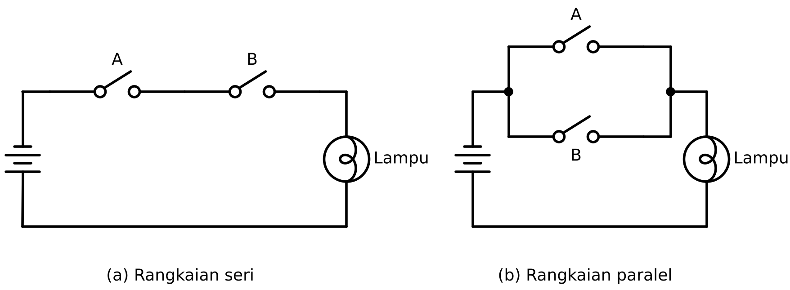

**Gambar 1 Sakelar seri berperilaku seperti AND, sedangkan sakelar paralel berperilaku seperti OR**

Pada rangkaian seri (Gambar 1a), arus hanya mengalir jika sakelar A *dan* sakelar B sama-sama tertutup. Pada rangkaian paralel (Gambar 1b), arus sudah mengalir jika salah satu sakelar tertutup, yaitu A *atau* B, atau keduanya.

**2.1 Gerbang NOT**

Gerbang NOT punya satu masukan. Keluarannya selalu kebalikan dari masukannya: masukan 0 menghasilkan 1, dan masukan 1 menghasilkan 0. Hasil NOT disebut **komplemen** atau **ingkaran**.

Dalam buku ini, komplemen A ditulis **A'** (dibaca "A aksen" atau "bukan A"). Di buku lain, Anda juga akan menjumpai tanda garis di atas huruf, yaitu Ā. Keduanya berarti sama.

**2.2 Gerbang AND**

Gerbang AND menghasilkan 1 *hanya jika semua* masukannya bernilai 1. Jika ada satu saja masukan yang bernilai 0, keluarannya 0. Operasi AND ditulis dengan titik, A·B, atau cukup ditulis berdampingan, AB. Karena mirip perkalian, hasil operasi AND disebut juga **hasil kali** (*product*).

**2.3 Gerbang OR**

Gerbang OR menghasilkan 1 jika *paling sedikit satu* masukannya bernilai 1. Keluarannya baru bernilai 0 jika semua masukan bernilai 0. Operasi OR ditulis dengan tanda tambah, A + B, sehingga hasilnya disebut juga **jumlah** (*sum*).

Hati-hati, tanda + di sini bukan penjumlahan biasa. Dalam aljabar Boolean, 1 + 1 = 1, bukan 2. Artinya, "benar atau benar" tetap "benar".

Gambar 2 memperlihatkan simbol ketiga gerbang dasar. Tabel 1 merangkum perilakunya.

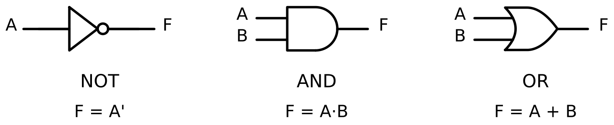

**Gambar 2 Simbol tiga gerbang dasar**

**Tabel 1 Tabel kebenaran tiga gerbang dasar**

| **A** | **B** | **NOT A (A')** | **A AND B (A·B)** | **A OR B (A + B)** |
|-------|-------|----------------|-------------------|--------------------|
| 0     | 0     | 1              | 0                 | 0                  |
| 0     | 1     | 1              | 0                 | 1                  |
| 1     | 0     | 0              | 0                 | 1                  |
| 1     | 1     | 0              | 1                 | 1                  |

Gerbang AND dan OR dapat memiliki lebih dari dua masukan. Aturannya tetap sama. AND tiga masukan menghasilkan 1 hanya jika ketiganya 1. OR tiga masukan menghasilkan 1 jika minimal satu masukannya 1.

Simbol yang dipakai dalam buku ini adalah simbol berbentuk khas (*distinctive shape*) yang lazim dipakai di buku teks. Ada juga simbol persegi panjang menurut standar IEC, dengan tanda & untuk AND, ≥1 untuk OR, dan =1 untuk XOR. Kedua jenis simbol menyatakan hal yang sama.

|                                                                                                                                                                                                                                                                                                                                                 |
|-------------------------------------------------------------------------------------------------------------------------------------------------------------------------------------------------------------------------------------------------------------------------------------------------------------------------------------------------|
| **Jangan tertukar: gerbang logika dan gerbang keputusan.** Pada pemodelan proses bisnis, ada lambang belah ketupat yang disebut *gerbang keputusan*. Lambang itu menandai titik tempat alur kerja bercabang, misalnya "Pelanggan meminta layanan kilat?". Gerbang logika adalah hal yang berbeda. Gerbang logika adalah komponen rangkaian yang mengolah sinyal 0 dan 1. Namanya mirip, tetapi bidang dan fungsinya tidak sama. |

**3 Gerbang turunan**

Dengan menggabungkan gerbang dasar, kita memperoleh empat gerbang lain yang sangat sering dipakai. Simbolnya ditunjukkan pada Gambar 3.

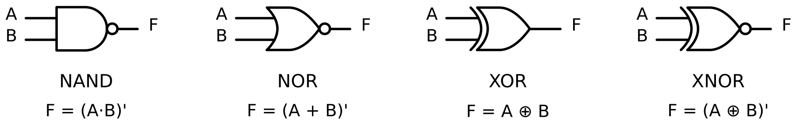

**Gambar 3 Simbol empat gerbang turunan**

- **NAND** (*NOT AND*) adalah AND yang keluarannya dibalik. Lingkaran kecil di ujung simbol menandakan pembalikan itu. Keluarannya 0 hanya jika semua masukan bernilai 1.

- **NOR** (*NOT OR*) adalah OR yang keluarannya dibalik. Keluarannya 1 hanya jika semua masukan bernilai 0.

- **XOR** (*exclusive OR*, "OR eksklusif") menghasilkan 1 jika kedua masukannya *berbeda*. Berbeda dengan OR biasa, XOR menghasilkan 0 ketika kedua masukan bernilai 1. Operasi XOR ditulis A ⊕ B.

- **XNOR** adalah XOR yang keluarannya dibalik. Keluarannya 1 jika kedua masukan *sama*. Karena itu, XNOR sering dipakai untuk memeriksa apakah dua bit sama.

**Tabel 2 Tabel kebenaran empat gerbang turunan**

| **A** | **B** | **NAND (A·B)'** | **NOR (A + B)'** | **XOR A ⊕ B** | **XNOR (A ⊕ B)'** |
|-------|-------|-----------------|------------------|---------------|-------------------|
| 0     | 0     | 1               | 1                | 0             | 1                 |
| 0     | 1     | 1               | 0                | 1             | 0                 |
| 1     | 0     | 1               | 0                | 1             | 0                 |
| 1     | 1     | 0               | 0                | 0             | 1                 |

Sekarang bandingkan kolom XOR dengan tabel lampu tangga di awal materi. Isinya persis sama. Jadi, perilaku lampu tangga adalah fungsi XOR: lampu menyala jika posisi kedua sakelar berbeda.

XOR juga dapat ditulis hanya dengan gerbang dasar, yaitu A ⊕ B = A'B + AB'. Bacalah ekspresi ini dengan kata-kata: "A mati dan B hidup, atau A hidup dan B mati." Itulah dua baris tempat lampu menyala. Cara menyusun ekspresi seperti ini dari tabel kebenaran dibahas di Subbab 5.

Satu catatan agar tidak salah paham. Di rumah sungguhan, lampu tangga tidak dibuat dengan gerbang logika, melainkan dengan dua sakelar khusus yang disebut sakelar tukar. Namun, aturan kerjanya tetap sama dengan fungsi XOR.

**3.1 NAND dan NOR sebagai gerbang universal**

NAND punya sifat istimewa: gerbang ini saja sudah cukup untuk membuat NOT, AND, dan OR. Karena ketiga gerbang dasar itu cukup untuk membuat fungsi logika apa pun, NAND disebut **gerbang universal**. Gambar 4 memperlihatkan caranya.

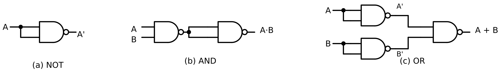

**Gambar 4 Membuat NOT, AND, dan OR hanya dengan gerbang NAND**

- **NOT** (Gambar 4a). Hubungkan kedua masukan NAND menjadi satu. Hasilnya (A·A)' = A'.

- **AND** (Gambar 4b). Pasang NAND, lalu balik keluarannya dengan NOT yang dibuat dari NAND. Pembalikan dua kali menghasilkan nilai semula: ((A·B)')' = A·B.

- **OR** (Gambar 4c). Balik masing-masing masukan, lalu masukkan ke NAND. Hasilnya (A'·B')' = A + B. Mengapa hasilnya OR? Alasannya adalah hukum De Morgan, yang akan dibahas di Subbab 6.2.

NOR juga merupakan gerbang universal dengan cara yang serupa. Sifat ini penting dalam industri. Pabrik cukup membuat satu jenis gerbang dalam jumlah sangat banyak, lalu menyusunnya menjadi rangkaian apa pun.

**4 Membaca dan membangun rangkaian**

**4.1 Urutan pengerjaan operator**

Seperti dalam aritmetika, kali dikerjakan sebelum tambah. Dalam aljabar Boolean, urutannya sebagai berikut:

1.  isi tanda kurung;

2.  NOT;

3.  AND;

4.  OR.

Jadi, A + B·C berarti A + (B·C), bukan (A + B)·C. Perhatikan juga letak tanda aksen. Pada A'B, yang dibalik hanya A. Pada (AB)', yang dibalik adalah hasil A·B. Kedua ekspresi ini berbeda, dan perbedaan ini sering menjadi sumber kesalahan.

**4.2 Dari rangkaian ke tabel kebenaran**

Perhatikan rangkaian pada Gambar 5.

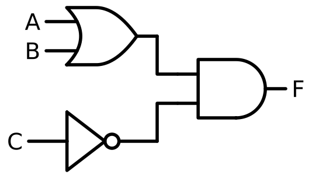

**Gambar 5 Rangkaian yang akan dibaca**

Cara membacanya adalah menelusuri sinyal dari kiri ke kanan dan memberi nama pada setiap kabel di antara gerbang.

1.  Keluaran gerbang OR kita sebut X. Jadi, X = A + B.

2.  Keluaran gerbang NOT kita sebut Y. Jadi, Y = C'.

3.  Gerbang AND menggabungkan keduanya, sehingga F = X·Y = (A + B)·C'.

Setelah ekspresinya diketahui, buatlah tabel kebenaran. Tambahkan kolom bantu untuk X dan Y agar perhitungan mudah diperiksa.

**Tabel 3 Tabel kebenaran rangkaian pada Gambar 5**

| **A** | **B** | **C** | **X = A + B** | **Y = C'** | **F = X·Y** |
|-------|-------|-------|---------------|------------|-------------|
| 0     | 0     | 0     | 0             | 1          | 0           |
| 0     | 0     | 1     | 0             | 0          | 0           |
| 0     | 1     | 0     | 1             | 1          | 1           |
| 0     | 1     | 1     | 1             | 0          | 0           |
| 1     | 0     | 0     | 1             | 1          | 1           |
| 1     | 0     | 1     | 1             | 0          | 0           |
| 1     | 1     | 0     | 1             | 1          | 1           |
| 1     | 1     | 1     | 1             | 0          | 0           |

Dengan kata-kata, rangkaian ini menghasilkan 1 jika A atau B bernilai 1 dan C bernilai 0.

**4.3 Dari ekspresi ke rangkaian**

Arah sebaliknya juga mudah. Mulailah dari operasi yang dikerjakan paling akhir, karena operasi itulah yang menjadi gerbang paling kanan. Pada F = (A + B)·C', operasi terakhir adalah AND. Jadi, gerbang paling kanan adalah AND. Masukan AND adalah (A + B) dan C'. Masukan pertama dibuat dengan gerbang OR, dan masukan kedua dibuat dengan gerbang NOT. Hasilnya adalah rangkaian pada Gambar 5.

**5 Dari tabel kebenaran ke ekspresi**

Dalam pekerjaan nyata, yang biasanya diketahui lebih dulu adalah kebutuhan, bukan rangkaian. Kebutuhan itu kita tuangkan menjadi tabel kebenaran, lalu dari tabel itu kita susun ekspresinya.

Sebagai contoh, sebuah panitia beranggotakan tiga orang, yaitu A, B, dan C. Sebuah usulan disetujui jika *paling sedikit dua* anggota setuju. Setuju ditulis 1, tidak setuju ditulis 0. Fungsi F bernilai 1 jika usulan disetujui. Fungsi semacam ini disebut **fungsi mayoritas**.

**Tabel 4 Tabel kebenaran fungsi mayoritas**

| **Baris** | **A** | **B** | **C** | **F** |
|-----------|-------|-------|-------|-------|
| 0         | 0     | 0     | 0     | 0     |
| 1         | 0     | 0     | 1     | 0     |
| 2         | 0     | 1     | 0     | 0     |
| 3         | 0     | 1     | 1     | 1     |
| 4         | 1     | 0     | 0     | 0     |
| 5         | 1     | 0     | 1     | 1     |
| 6         | 1     | 1     | 0     | 1     |
| 7         | 1     | 1     | 1     | 1     |

Nomor baris adalah nilai desimal dari bilangan biner ABC. Misalnya, baris 5 adalah ABC = 101.

**5.1 Minterm dan bentuk jumlah hasil kali**

Setiap baris yang keluarannya 1 dapat ditulis sebagai satu suku AND yang memuat *semua* variabel. Suku ini disebut **minterm**. Aturannya sederhana:

- variabel yang bernilai 1 ditulis apa adanya;

- variabel yang bernilai 0 ditulis dengan aksen.

Sebagai contoh, baris 3 (ABC = 011) menjadi A'BC. Suku ini bernilai 1 hanya pada baris 3 dan bernilai 0 pada semua baris lain.

Setelah semua minterm ditulis, gabungkan dengan OR. Hasilnya disebut bentuk **jumlah hasil kali** (*sum of products*, SOP). Untuk fungsi mayoritas:

F = A'BC + AB'C + ABC' + ABC

Bentuk ini juga dapat ditulis ringkas dengan nomor barisnya:

F = Σm(3, 5, 6, 7)

Tanda Σm dibaca "jumlah minterm". Bentuk SOP yang setiap sukunya memuat semua variabel disebut **bentuk kanonik**. Bentuk ini pasti benar karena langsung disalin dari tabel. Namun, bentuk ini hampir selalu bukan bentuk yang paling hemat.

**5.2 Bentuk hasil kali jumlah**

Ada cara lain, yaitu dengan memakai baris yang keluarannya **0**. Setiap baris 0 ditulis sebagai satu suku OR yang disebut **maxterm**. Aturannya terbalik dari minterm: variabel bernilai 0 ditulis apa adanya, sedangkan variabel bernilai 1 ditulis dengan aksen. Semua maxterm lalu digabungkan dengan AND. Hasilnya disebut bentuk **hasil kali jumlah** (*product of sums*, POS).

Untuk fungsi mayoritas, baris yang bernilai 0 adalah 0, 1, 2, dan 4, sehingga:

F = (A + B + C)(A + B + C')(A + B' + C)(A' + B + C)

Kedua bentuk itu menyatakan fungsi yang sama. Materi ini selanjutnya berfokus pada bentuk SOP karena lebih sering dipakai dan lebih mudah disederhanakan oleh pemula.

**5.3 Mengapa perlu disederhanakan**

Bentuk kanonik fungsi mayoritas membutuhkan empat gerbang AND tiga masukan, satu gerbang OR empat masukan, dan beberapa gerbang NOT. Nanti Anda akan melihat bahwa fungsi yang sama dapat ditulis sebagai:

F = AB + AC + BC

Bentuk ini hanya membutuhkan tiga gerbang AND dua masukan, satu gerbang OR tiga masukan, dan tidak membutuhkan NOT sama sekali. Perilakunya sama persis, tetapi biayanya jauh lebih kecil.

Dalam rangkaian sungguhan, lebih sedikit gerbang berarti biaya lebih murah, ukuran lebih kecil, daya lebih hemat, dan peluang kesalahan perakitan lebih kecil. Ada dua cara untuk menyederhanakan fungsi, yaitu aljabar Boolean dan peta Karnaugh.

**6 Aljabar Boolean**

**6.1 Hukum-hukum dasar**

Aljabar Boolean punya hukum-hukum seperti aljabar biasa. Namun, beberapa hukumnya terasa aneh jika Anda terbiasa dengan aritmetika. Tabel 5 merangkum hukum yang paling sering dipakai.

**Tabel 5 Hukum-hukum aljabar Boolean**

| **Nama hukum**   | **Bentuk OR**             | **Bentuk AND**                | **Cara mengingat**                                |
|------------------|---------------------------|-------------------------------|---------------------------------------------------|
| Identitas        | A + 0 = A                 | A·1 = A                       | Menambah "salah" atau mengalikan "benar" tidak mengubah apa pun. |
| Dominasi         | A + 1 = 1                 | A·0 = 0                       | Satu "benar" membuat OR benar; satu "salah" membuat AND salah. |
| Idempoten        | A + A = A                 | A·A = A                       | Menyebut hal yang sama dua kali tidak menambah apa-apa. |
| Komplemen        | A + A' = 1                | A·A' = 0                      | Sesuatu pasti benar atau salah, tetapi tidak keduanya. |
| Involusi         | (A')' = A                 |                               | Dibalik dua kali kembali seperti semula.          |
| Komutatif        | A + B = B + A             | A·B = B·A                     | Urutan tidak berpengaruh.                         |
| Asosiatif        | A + (B + C) = (A + B) + C | A·(B·C) = (A·B)·C             | Pengelompokan tidak berpengaruh.                  |
| Distributif      | A·(B + C) = A·B + A·C     | A + B·C = (A + B)·(A + C)     | Bentuk kedua tidak berlaku pada aritmetika biasa. |
| Penyerapan       | A + A·B = A               | A·(A + B) = A                 | Suku yang lebih panjang "terserap" oleh suku yang lebih pendek. |
| De Morgan        | (A + B)' = A'·B'          | (A·B)' = A' + B'              | Pisahkan aksennya, lalu tukar operatornya.        |

Satu bentuk turunan juga sangat berguna:

A + A'B = A + B

Artinya, jika A sudah 1, keluarannya pasti 1. Jika A bernilai 0, A' bernilai 1, sehingga hasilnya hanya ditentukan oleh B. Jadi, syarat A' pada suku kedua tidak diperlukan.

Setiap hukum dapat dibuktikan dengan tabel kebenaran. Caranya, hitung kedua ruas untuk semua kombinasi masukan. Jika semua baris sama, hukum itu terbukti.

**6.2 Hukum De Morgan**

Hukum De Morgan paling sering dipakai sekaligus paling sering salah diterapkan. Ingat dua langkahnya: **pisahkan** tanda aksen ke setiap variabel, lalu **tukar** operatornya, AND menjadi OR dan OR menjadi AND.

- (A·B)' = A' + B'. "Tidak benar bahwa A dan B keduanya benar" sama dengan "A salah atau B salah".

- (A + B)' = A'·B'. "Tidak benar bahwa A atau B benar" sama dengan "A salah dan B salah".

Hukum inilah yang menjelaskan Gambar 4c. Pada gambar itu, NAND menerima A' dan B', sehingga keluarannya (A'·B')'. Menurut De Morgan, (A'·B')' = (A')' + (B')' = A + B.

**6.3 Contoh penyederhanaan langkah demi langkah**

Tuliskan nama hukum yang dipakai pada setiap langkah. Kebiasaan ini membuat pekerjaan Anda mudah diperiksa, baik oleh Anda sendiri maupun oleh orang lain.

**Contoh 1.** Sederhanakan F = AB + AB'.

| **Langkah**  | **Hukum**    |
|--------------|--------------|
| F = A(B + B') | Distributif |
| F = A·1      | Komplemen    |
| F = A        | Identitas    |

Nilai B ternyata tidak berpengaruh. Asalkan A bernilai 1, F pasti bernilai 1.

**Contoh 2.** Sederhanakan F = A'BC + ABC + ABC'.

| **Langkah**          | **Hukum**                                  |
|----------------------|--------------------------------------------|
| F = BC(A' + A) + ABC' | Distributif pada dua suku pertama         |
| F = BC + ABC'        | Komplemen, lalu identitas                  |
| F = B(C + AC')       | Distributif                                |
| F = B(C + A)         | Bentuk turunan C + C'A = C + A             |
| F = BC + AB          | Distributif                                |

**Contoh 3.** Sederhanakan F = (A'B)' + A.

| **Langkah**      | **Hukum**    |
|------------------|--------------|
| F = (A')' + B' + A | De Morgan  |
| F = A + B' + A   | Involusi     |
| F = A + B'       | Idempoten    |

**6.4 Kelemahan cara aljabar**

Sekarang, coba sederhanakan bentuk kanonik fungsi mayoritas, yaitu F = A'BC + AB'C + ABC' + ABC. Penyelesaiannya membutuhkan satu trik. Suku ABC harus ditulis tiga kali, dan langkah ini diperbolehkan karena hukum idempoten.

F = (A'BC + ABC) + (AB'C + ABC) + (ABC' + ABC)

F = BC(A' + A) + AC(B' + B) + AB(C' + C)

F = BC + AC + AB

Trik seperti ini tidak mudah ditemukan. Di situlah kelemahan cara aljabar. Pertama, tidak ada urutan langkah yang pasti, sehingga keberhasilannya bergantung pada pengalaman. Kedua, Anda tidak pernah benar-benar yakin apakah hasilnya sudah paling sederhana atau masih dapat disederhanakan lagi.

Peta Karnaugh mengatasi kedua kelemahan ini dengan mengubah pencarian trik menjadi kegiatan melihat pola.

**7 Peta Karnaugh**

**7.1 Gagasan dasar**

Perhatikan kembali Contoh 1: AB + AB' = A. Dua suku yang berbeda *hanya pada satu variabel* selalu dapat digabung, dan variabel yang berbeda itu hilang. Seluruh penyederhanaan SOP pada dasarnya hanyalah pengulangan langkah ini.

**Peta Karnaugh** (diperkenalkan oleh Maurice Karnaugh pada tahun 1953) adalah tabel kebenaran yang disusun ulang menjadi kotak-kotak. Susunannya diatur sehingga dua kotak yang bersebelahan *selalu berbeda tepat satu variabel*. Dengan susunan ini, pasangan suku yang dapat digabung langsung terlihat sebagai kotak-kotak 1 yang bersebelahan.

Kuncinya ada pada urutan label baris dan kolom. Labelnya tidak diurutkan seperti hitungan biner biasa (00, 01, 10, 11), tetapi menurut **kode Gray**: **00, 01, 11, 10**. Dalam urutan ini, setiap langkah hanya mengubah satu bit, termasuk langkah dari 10 kembali ke 00.

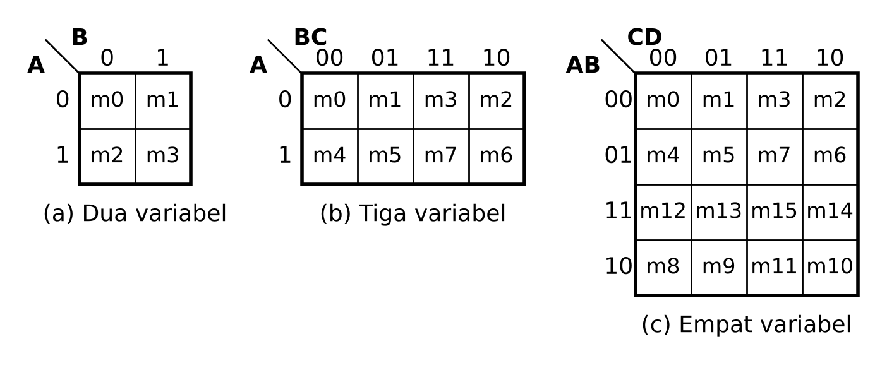

**Gambar 6 Tata letak peta Karnaugh untuk dua, tiga, dan empat variabel, beserta nomor minterm pada setiap kotak**

Perhatikan peta empat variabel pada Gambar 6c. Kotak m2 berada di sebelah kanan m3, bukan di sebelah kanan m1. Baris m12 sampai m14 berada di atas baris m8 sampai m10. Urutan inilah yang membuat setiap kotak hanya berbeda satu variabel dengan tetangganya.

Ada satu sifat lagi yang penting. **Tepi kiri dan tepi kanan peta dianggap bersambung**, begitu pula tepi atas dan tepi bawah. Kolom 00 dan kolom 10 juga hanya berbeda satu bit. Jadi, bayangkan peta itu digulung seperti tabung.

**7.2 Mengisi peta**

Cara mengisi peta adalah memindahkan keluaran setiap baris tabel kebenaran ke kotak yang nomornya sama. Untuk fungsi mayoritas F = Σm(3, 5, 6, 7), tulis 1 pada kotak m3, m5, m6, dan m7, lalu tulis 0 pada kotak lainnya. Dalam praktik, angka 0 boleh tidak ditulis agar peta lebih bersih.

**7.3 Aturan mengelompokkan**

Setelah peta terisi, lingkari angka-angka 1 dalam kelompok dengan aturan berikut.

1.  **Kelompok harus berbentuk persegi panjang** atau persegi. Bentuk L atau zig-zag tidak boleh.

2.  **Ukuran kelompok harus 1, 2, 4, 8, atau 16 kotak**, yaitu bilangan pangkat dua. Kelompok berisi 3 atau 6 kotak tidak boleh.

3.  **Kelompok hanya boleh berisi angka 1** (atau tanda X yang dibahas di Subbab 7.7). Satu angka 0 pun tidak boleh masuk.

4.  **Buatlah kelompok sebesar mungkin.** Semakin besar kelompok, semakin banyak variabel yang hilang.

5.  **Buatlah kelompok sesedikit mungkin.** Setiap kelompok akan menjadi satu gerbang AND.

6.  **Kelompok boleh tumpang tindih.** Satu angka 1 boleh dilingkari lebih dari sekali jika hal itu membuat kelompok lain menjadi lebih besar.

7.  **Kelompok boleh melintasi tepi peta**, karena tepi yang berseberangan dianggap bersambung. Keempat sudut peta empat variabel juga saling bertetangga.

8.  **Setiap angka 1 harus masuk ke paling sedikit satu kelompok.**

Kelompok yang tidak memuat satu pun angka 1 "milik sendiri", artinya semua angka 1 di dalamnya sudah tercakup oleh kelompok lain, adalah kelompok yang berlebih. Hapus kelompok seperti itu.

**7.4 Membaca kelompok menjadi suku**

Setiap kelompok menjadi satu suku AND. Untuk membacanya, periksa setiap variabel di dalam kelompok itu.

- Jika nilai variabel **tetap 1** di seluruh kelompok, tulis variabel itu apa adanya.

- Jika nilainya **tetap 0**, tulis variabel itu dengan aksen.

- Jika nilainya **berubah-ubah**, berarti variabel itu tidak berpengaruh, sehingga tidak ditulis.

Kelompok 2 kotak menghilangkan satu variabel, kelompok 4 kotak menghilangkan dua variabel, dan kelompok 8 kotak menghilangkan tiga variabel. Terakhir, gabungkan semua suku dengan OR.

**7.5 Contoh tiga variabel: fungsi mayoritas**

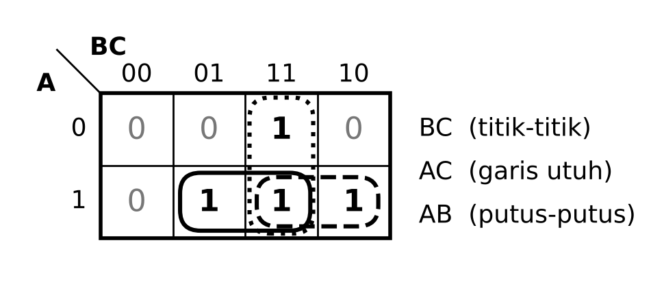

**Gambar 7 Peta Karnaugh fungsi mayoritas dengan tiga kelompok yang saling tumpang tindih**

Pada Gambar 7, kotak m7 (ABC = 111) dipakai oleh ketiga kelompok. Hal ini diperbolehkan oleh aturan 6.

- Kelompok titik-titik berada di kolom BC = 11 dan mencakup kedua baris. Nilai A berubah-ubah, sedangkan B dan C tetap 1. Jadi, sukunya adalah **BC**.

- Kelompok garis utuh berada di baris A = 1, kolom 01 dan 11. A tetap 1, C tetap 1, sedangkan B berubah-ubah. Jadi, sukunya adalah **AC**.

- Kelompok putus-putus berada di baris A = 1, kolom 11 dan 10. A tetap 1, B tetap 1, sedangkan C berubah-ubah. Jadi, sukunya adalah **AB**.

Hasilnya F = AB + AC + BC. Hasil ini sama dengan hasil aljabar di Subbab 6.4, tetapi diperoleh tanpa perlu mencari trik.

**7.6 Contoh empat variabel dan tepi yang bersambung**

Sederhanakan F(A, B, C, D) = Σm(0, 2, 5, 7, 8, 10, 13, 15).

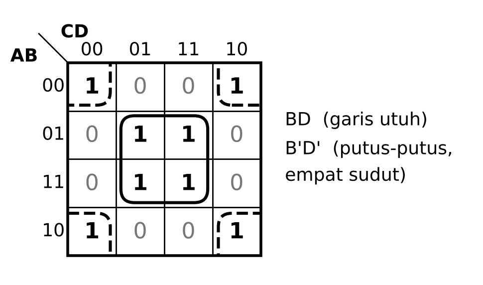

**Gambar 8 Kelompok di tengah peta dan kelompok yang dibentuk oleh keempat sudut**

Di tengah peta (Gambar 8) ada empat angka 1 yang membentuk persegi, yaitu m5, m7, m13, dan m15. Di dalam kelompok itu, B tetap 1 dan D tetap 1, sedangkan A dan C berubah-ubah. Jadi, sukunya adalah **BD**.

Empat angka 1 lainnya berada di keempat sudut. Sekilas, keempatnya tampak berjauhan. Namun, karena tepi kiri bersambung dengan tepi kanan dan tepi atas bersambung dengan tepi bawah, keempat sudut itu sebenarnya membentuk satu kelompok berisi empat kotak. Di keempat sudut, B selalu 0 dan D selalu 0. Jadi, sukunya adalah **B'D'**.

Hasilnya F = BD + B'D'. Delapan minterm yang masing-masing memuat empat variabel ternyata cukup diganti dengan dua suku yang masing-masing memuat dua variabel. Fungsi ini menghasilkan 1 jika B dan D bernilai sama. Dengan kata lain, fungsi ini adalah XNOR dari B dan D, sedangkan A dan C sama sekali tidak berpengaruh.

**7.7 Keadaan tak peduli**

Kadang-kadang, ada kombinasi masukan yang *tidak mungkin terjadi* atau keluarannya *tidak penting*. Untuk kombinasi seperti itu, keluarannya ditulis **X** dan disebut **keadaan tak peduli** (*don't care*).

Contohnya adalah rangkaian yang menerima satu angka desimal 0 sampai 9 dalam bentuk biner empat bit, yaitu ABCD. Rangkaian harus menghasilkan 1 jika angkanya 5 atau lebih. Kombinasi 1010 sampai 1111 (desimal 10 sampai 15) tidak pernah muncul karena bukan angka desimal yang sah. Jadi:

F = Σm(5, 6, 7, 8, 9) + d(10, 11, 12, 13, 14, 15)

Huruf d menandai daftar keadaan tak peduli.

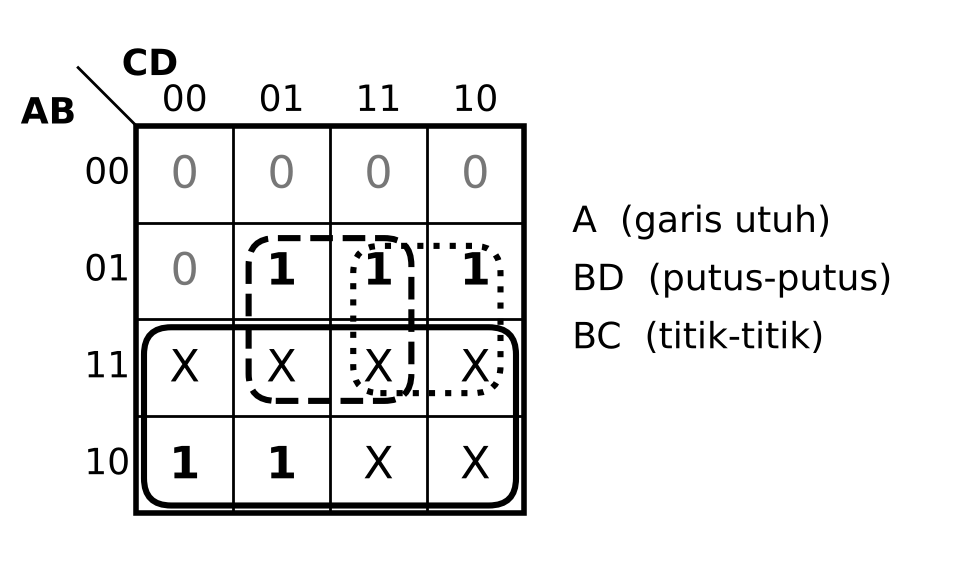

**Gambar 9 Keadaan tak peduli (X) dipakai untuk memperbesar kelompok**

Aturan pemakaian X adalah sebagai berikut: **X boleh dimasukkan ke kelompok jika hal itu membuat kelompok lebih besar, dan boleh diabaikan jika tidak membantu.** X tidak wajib dilingkari. Kelompok yang hanya berisi X juga tidak perlu dibuat, karena tidak mencakup satu pun angka 1.

Pada Gambar 9, kedelapan kotak di dua baris terbawah (m8 sampai m15) membentuk satu kelompok. Dari delapan kotak itu, enam kotak adalah X. Di seluruh kelompok, A tetap 1, sehingga sukunya hanya **A**. Dua kelompok lain, yaitu **BD** dan **BC**, juga memanfaatkan X untuk mencakup m5, m6, dan m7.

Hasilnya F = A + BD + BC. Tanpa memanfaatkan X, hasilnya akan jauh lebih panjang.

**7.8 Batas peta Karnaugh**

Ada dua hal yang perlu Anda ketahui tentang peta Karnaugh.

**Hasil sederhana tidak selalu tunggal.** Pada beberapa fungsi, ada dua cara pengelompokan atau lebih yang sama-sama menghasilkan jumlah suku dan jumlah variabel paling sedikit. Semuanya benar. Jadi, jawaban yang berbeda dari kunci belum tentu salah. Periksalah dengan tabel kebenaran.

**Peta Karnaugh praktis hanya sampai empat variabel.** Pada lima atau enam variabel, peta harus dibuat bertumpuk dan pola tetangganya sulit dilihat. Untuk fungsi yang lebih besar, perancang memakai metode tabel seperti metode Quine–McCluskey atau perangkat lunak perancangan rangkaian. Metode-metode itu berada di luar cakupan materi ini.

**8 Tujuh kesalahan yang sering terjadi**

**Kesalahan 1 Mengurutkan label peta seperti hitungan biner biasa**

Cirinya, label kolom ditulis 00, 01, 10, 11. Akibatnya, kotak yang bersebelahan tidak lagi berbeda satu variabel, sehingga semua kelompok yang dibuat menjadi salah. Urutan yang benar adalah 00, 01, 11, 10.

**Kesalahan 2 Membuat kelompok berisi 3 atau 6 kotak**

Tiga kotak tidak dapat ditulis sebagai satu suku AND, sehingga kelompok seperti itu tidak bermakna. Pecahlah menjadi dua kelompok berisi 2 kotak yang tumpang tindih.

**Kesalahan 3 Lupa bahwa tepi peta bersambung**

Cirinya, angka 1 di kolom paling kiri dan paling kanan dilingkari terpisah-pisah. Akibatnya, hasilnya benar tetapi tidak paling sederhana. Selalu periksa tepi dan keempat sudut.

**Kesalahan 4 Salah menerapkan De Morgan**

Kesalahan paling umum adalah menulis (A·B)' = A'·B'. Ini salah. Operatornya harus ditukar, sehingga (A·B)' = A' + B'. Uji dengan A = 1 dan B = 0. Ruas kiri bernilai (1·0)' = 1, sedangkan A'·B' = 0·1 = 0. Hasilnya tidak sama.

**Kesalahan 5 Mengira letak aksen tidak penting**

Ekspresi A'B dan (AB)' sangat berbeda. Pada A'B, hanya A yang dibalik. Pada (AB)', yang dibalik adalah hasil A·B. Saat menyalin ekspresi, jangan menggeser atau memperpanjang tanda aksen.

**Kesalahan 6 Menganggap XOR sama dengan OR**

Dalam bahasa sehari-hari, kata "atau" kadang berarti "salah satu, tetapi tidak keduanya", dan kadang berarti "salah satu atau keduanya". Dalam logika, OR berarti "salah satu atau keduanya", sedangkan XOR berarti "tepat salah satu". Saat menerjemahkan kebutuhan menjadi fungsi, tanyakan kepada pemberi kebutuhan: jika kedua syarat terpenuhi, apakah keluarannya 1 atau 0?

**Kesalahan 7 Berhenti pada kelompok yang lebih kecil dari seharusnya**

Cirinya, kelompok sudah dibuat dan semua angka 1 sudah tercakup, tetapi masih ada kelompok 2 kotak yang sebenarnya dapat diperbesar menjadi 4 kotak. Hasilnya benar tetapi tidak paling sederhana. Sebelum membaca hasil, tanyakan pada setiap kelompok: apakah kelompok ini masih dapat diperbesar?

**Studi kasus terpandu: lampu peringatan mesin pengering**

**Cerita dari lapangan**

Sebuah usaha binatu memakai mesin pengering yang punya lampu peringatan merah. Teknisi yang merakitnya meninggalkan catatan tulisan tangan. Isinya kurang lebih begini:

"Lampu merah harus menyala kalau:

1.  mesin berputar dan pintu terbuka;

2.  mesin berputar, pintu tertutup, dan filter penuh;

3.  suhu terlalu tinggi dan mesin berhenti;

4.  suhu terlalu tinggi, mesin berputar, dan pintu tertutup;

5.  suhu terlalu tinggi dan pintu terbuka."

Rangkaian yang terpasang sekarang dibuat persis menurut catatan itu, yaitu satu gerbang AND untuk setiap aturan. Rangkaian tersebut ditunjukkan pada Gambar 10. Pemilik binatu ingin membuat rangkaian pengganti yang lebih ringkas, tetapi perilakunya tidak boleh berubah sedikit pun.

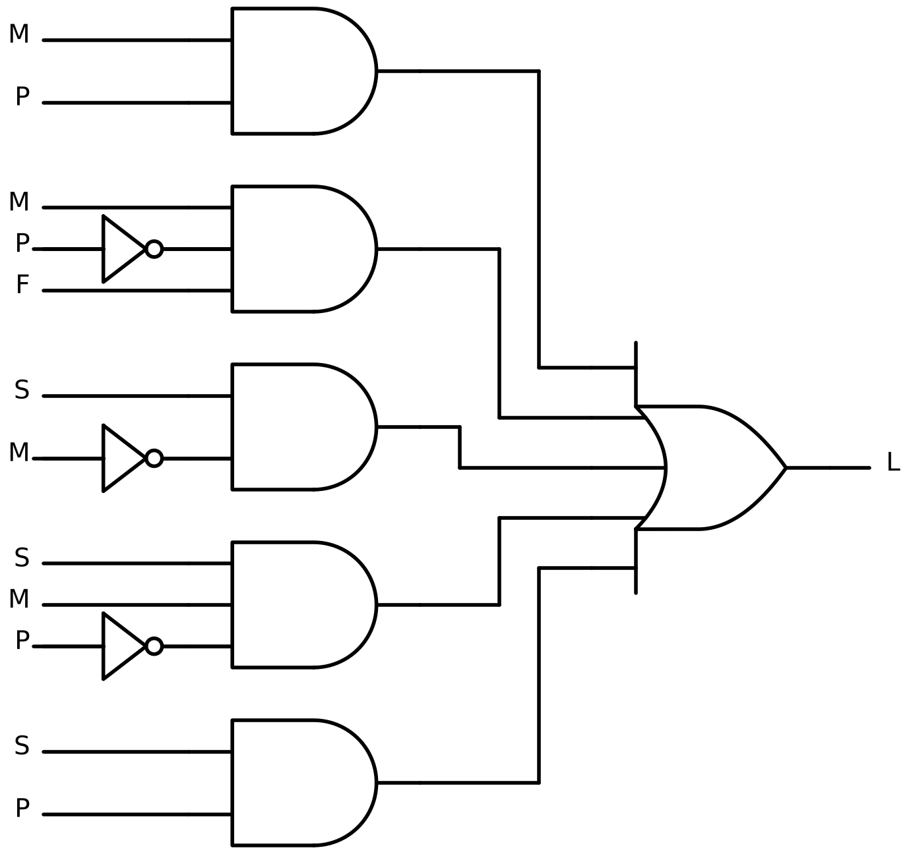

**Gambar 10 Rangkaian lampu peringatan menurut catatan teknisi, sebelum disederhanakan**

**Langkah 1 Tetapkan variabel**

| **Variabel** | **Bernilai 1 jika**     | **Bernilai 0 jika**     |
|--------------|-------------------------|-------------------------|
| M            | mesin berputar          | mesin berhenti          |
| P            | pintu terbuka           | pintu tertutup          |
| S            | suhu terlalu tinggi     | suhu normal             |
| F            | filter penuh            | filter tidak penuh      |
| L (keluaran) | lampu merah menyala     | lampu merah padam       |

Perhatikan arah nilai P. Nilai 1 berarti pintu *terbuka*. Jadi, "pintu tertutup" ditulis P'. Menetapkan arti setiap variabel secara tertulis di awal pekerjaan dapat mencegah banyak kesalahan di langkah berikutnya.

**Langkah 2 Terjemahkan catatan menjadi ekspresi**

Setiap aturan diterjemahkan menjadi satu suku AND, lalu kelima suku digabung dengan OR.

L = MP + MP'F + SM' + SMP' + SP

Ekspresi ini memuat lima suku dan dua belas variabel. Rangkaiannya pada Gambar 10 memakai lima gerbang AND, satu gerbang OR lima masukan, dan tiga gerbang NOT, sehingga totalnya sembilan gerbang.

**Langkah 3 Susun tabel kebenaran**

Tabel kebenaran berfungsi sebagai alat periksa. Kolom terakhir pada Tabel 6 menunjukkan aturan mana yang menyalakan lampu pada setiap baris.

**Tabel 6 Tabel kebenaran lampu peringatan**

| **Baris** | **M** | **P** | **S** | **F** | **L** | **Aturan yang terpenuhi** |
|-----------|-------|-------|-------|-------|-------|---------------------------|
| 0         | 0     | 0     | 0     | 0     | 0     | —                         |
| 1         | 0     | 0     | 0     | 1     | 0     | —                         |
| 2         | 0     | 0     | 1     | 0     | 1     | 3                         |
| 3         | 0     | 0     | 1     | 1     | 1     | 3                         |
| 4         | 0     | 1     | 0     | 0     | 0     | —                         |
| 5         | 0     | 1     | 0     | 1     | 0     | —                         |
| 6         | 0     | 1     | 1     | 0     | 1     | 3, 5                      |
| 7         | 0     | 1     | 1     | 1     | 1     | 3, 5                      |
| 8         | 1     | 0     | 0     | 0     | 0     | —                         |
| 9         | 1     | 0     | 0     | 1     | 1     | 2                         |
| 10        | 1     | 0     | 1     | 0     | 1     | 4                         |
| 11        | 1     | 0     | 1     | 1     | 1     | 2, 4                      |
| 12        | 1     | 1     | 0     | 0     | 1     | 1                         |
| 13        | 1     | 1     | 0     | 1     | 1     | 1                         |
| 14        | 1     | 1     | 1     | 0     | 1     | 1, 5                      |
| 15        | 1     | 1     | 1     | 1     | 1     | 1, 5                      |

Ada dua hal yang langsung terlihat. Pertama, beberapa baris dipenuhi oleh dua aturan sekaligus. Artinya, aturan-aturan teknisi itu saling tumpang tindih. Kedua, *setiap* baris dengan S = 1 menghasilkan L = 1. Petunjuk kedua ini akan terlihat jelas di peta.

Jadi, L = Σm(2, 3, 6, 7, 9, 10, 11, 12, 13, 14, 15).

**Langkah 4 Isi peta dan kelompokkan**

Baris peta diberi label MP, dan kolomnya diberi label SF. Keduanya diurutkan menurut kode Gray.

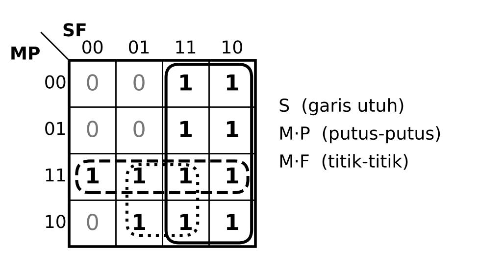

**Gambar 11 Peta Karnaugh lampu peringatan dengan tiga kelompok**

- **Kelompok garis utuh** berisi delapan kotak, yaitu seluruh kolom SF = 11 dan SF = 10. Di kedua kolom itu, S tetap 1, sedangkan M, P, dan F berubah-ubah. Sukunya adalah **S**.

- **Kelompok putus-putus** berisi empat kotak, yaitu seluruh baris MP = 11. M dan P tetap 1. Sukunya adalah **MP**.

- **Kelompok titik-titik** berisi empat kotak, yaitu baris MP = 11 dan 10 pada kolom SF = 01 dan 11. M tetap 1 dan F tetap 1. Sukunya adalah **MF**.

Periksa apakah ada angka 1 yang belum tercakup. Hasilnya, tidak ada. Periksa juga apakah ada kelompok yang berlebih. Kelompok MP adalah satu-satunya kelompok yang mencakup m12. Kelompok MF adalah satu-satunya kelompok yang mencakup m9. Kelompok S adalah satu-satunya kelompok yang mencakup m2. Jadi, ketiga kelompok itu diperlukan.

**Langkah 5 Tulis hasil dan bandingkan**

L = S + MP + MF

Rangkaian hasil penyederhanaan ditunjukkan pada Gambar 12.

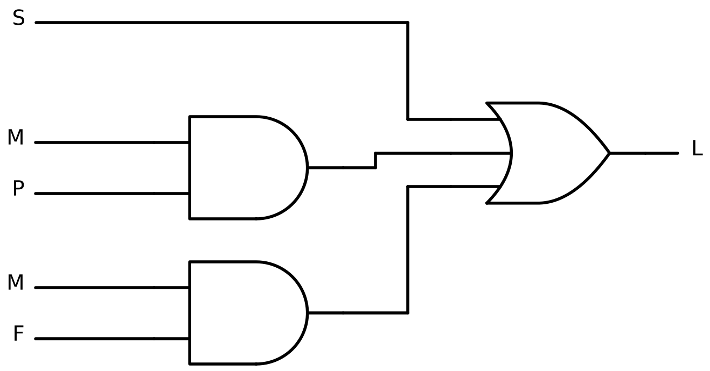

**Gambar 12 Rangkaian lampu peringatan setelah disederhanakan**

| **Ukuran**             | **Sebelum** | **Sesudah** |
|------------------------|-------------|-------------|
| Jumlah suku            | 5           | 3           |
| Jumlah variabel ditulis | 12         | 5           |
| Gerbang AND            | 5           | 2           |
| Gerbang OR             | 1 (5 masukan) | 1 (3 masukan) |
| Gerbang NOT            | 3           | 0           |
| Total gerbang          | 9           | 3           |

**Langkah 6 Uji dan tafsirkan**

Ujilah beberapa baris dengan rangkaian baru, terutama baris yang tadinya dipenuhi oleh lebih dari satu aturan.

- **Baris 11** (M = 1, P = 0, S = 1, F = 1): S = 1, maka L = 1. Hasil ini sesuai dengan Tabel 6.

- **Baris 9** (M = 1, P = 0, S = 0, F = 1): S = 0 dan MP = 0, tetapi MF = 1, maka L = 1. Hasil ini sesuai.

- **Baris 5** (M = 0, P = 1, S = 0, F = 1): S = 0, MP = 0, dan MF = 0, maka L = 0. Hasil ini sesuai.

Pengujian yang lengkap dilakukan untuk keenam belas baris. Pekerjaan ini akan Anda lakukan sendiri pada latihan.

Sekarang bacalah hasil penyederhanaan itu dengan kata-kata: "Lampu menyala jika suhu terlalu tinggi, *apa pun* keadaan lainnya; atau jika mesin berputar sementara pintu terbuka; atau jika mesin berputar sementara filter penuh."

Kalimat ini jauh lebih mudah dipahami daripada catatan asli. Teknisi menulis tiga aturan terpisah tentang suhu, yaitu aturan 3, 4, dan 5, untuk menutup berbagai keadaan satu per satu. Penyederhanaan menunjukkan bahwa ketiga aturan itu sebenarnya berarti satu hal: suhu terlalu tinggi selalu berbahaya.

Di sini ada pelajaran yang melampaui rangkaian. Bentuk sederhana bukan hanya lebih murah, tetapi juga *lebih mudah diperiksa maksudnya*. Sebelum rangkaian baru dipasang, ada baiknya kalimat sederhana itu ditunjukkan kepada teknisi untuk memastikan bahwa memang itulah yang ia maksud. Penyederhanaan tidak mengubah perilaku rangkaian. Namun, penyederhanaan dapat memperlihatkan bahwa catatan aslinya belum tentu menggambarkan maksud penulisnya dengan tepat.

**Rangkuman**

- Rangkaian digital membaca tegangan sebagai dua rentang, yaitu rendah (0) dan tinggi (1). Dengan dua nilai, sinyal tetap terbaca dengan benar walaupun tegangannya sedikit bergeser.

- Tabel kebenaran adalah cara paling lengkap untuk menyatakan fungsi logika. Fungsi dengan n variabel membutuhkan 2ⁿ baris.

- Tiga gerbang dasar adalah NOT, AND, dan OR. Gerbang turunannya adalah NAND, NOR, XOR, dan XNOR. NAND dan NOR disebut gerbang universal karena masing-masing cukup untuk membuat fungsi logika apa pun.

- XOR menghasilkan 1 jika kedua masukan berbeda. Perilaku lampu tangga adalah contoh fungsi XOR.

- Dari tabel kebenaran, setiap baris bernilai 1 ditulis sebagai minterm, lalu semua minterm digabungkan dengan OR. Hasilnya adalah bentuk jumlah hasil kali kanonik. Bentuk ini pasti benar, tetapi jarang yang paling hemat.

- Aljabar Boolean dapat menyederhanakan fungsi, tetapi tidak memberi urutan langkah yang pasti dan tidak menjamin hasil paling sederhana. Hukum De Morgan adalah hukum yang paling sering salah diterapkan.

- Peta Karnaugh menyusun kotak menurut kode Gray, sehingga kotak yang bersebelahan selalu berbeda satu variabel. Kelompokkan angka 1 dalam persegi panjang berukuran pangkat dua, sebesar dan sesedikit mungkin. Ingat bahwa tepi peta saling bersambung.

- Keadaan tak peduli (X) boleh dipakai untuk memperbesar kelompok, tetapi tidak wajib dilingkari.

- Bentuk sederhana bukan hanya lebih murah, tetapi juga lebih mudah dibaca maksudnya. Karena itu, bentuk sederhana berguna untuk memeriksa ulang kebutuhan bersama pemberi kebutuhan.

**Latihan**

Setiap soal ditandai dengan Sub-CPMK yang diukurnya.

**Tingkat A Memastikan Anda ingat**

1.  Tuliskan tabel kebenaran gerbang NAND dan NOR dua masukan. Pada baris mana keduanya memberi keluaran yang sama? \[Sub-CPMK-RL\]

2.  Jelaskan perbedaan OR dan XOR. Berikan satu contoh kalimat sehari-hari yang memakai kata "atau" dalam arti XOR. \[Sub-CPMK-RL\]

3.  Mengapa NAND disebut gerbang universal? Tunjukkan cara membuat gerbang NOT hanya dengan NAND. \[Sub-CPMK-RL\]

4.  Mengapa label baris dan kolom peta Karnaugh diurutkan 00, 01, 11, 10, bukan 00, 01, 10, 11? \[Sub-CPMK-RL\]

5.  Sebutkan tiga aturan pengelompokan pada peta Karnaugh beserta alasan setiap aturan. \[Sub-CPMK-RL\]

**Tingkat B Menerapkan**

1.  Buatlah tabel kebenaran untuk F = A'B + BC'. Gambarlah rangkaiannya dengan gerbang NOT, AND, dan OR. \[Sub-CPMK-RL\]

2.  Sederhanakan F = AB + A(B + C) + B(B + C) dengan aljabar Boolean. Tuliskan nama hukum pada setiap langkah. \[Sub-CPMK-RL\]

3.  Sederhanakan F(A, B, C) = Σm(0, 1, 2, 5) dengan peta Karnaugh. \[Sub-CPMK-RL\]

4.  Sederhanakan F(A, B, C, D) = Σm(0, 1, 4, 5, 6, 7, 14, 15) dengan peta Karnaugh. \[Sub-CPMK-RL\]

5.  Sederhanakan F(A, B, C, D) = Σm(1, 3, 7, 11, 15) + d(0, 2, 5) dengan peta Karnaugh. Apakah hasil paling sederhananya hanya satu? \[Sub-CPMK-RL\]

6.  Gunakan Tabel 6. Ujilah rangkaian pada Gambar 12 untuk keenam belas baris. Tunjukkan bahwa hasilnya selalu sama dengan kolom L. \[Sub-CPMK-RL\]

**Tingkat C Menganalisis dan menilai**

1.  Petugas kebun kampus meminta penyiram otomatis dengan pesan berikut: "Kalau tanah kering dan tidak hujan, siram. Pada jam penyiraman juga siram, kecuali kalau hujan. Tapi jangan pernah menyalakan pompa kalau tangki kosong." Tetapkan variabelnya, susun tabel kebenaran, sederhanakan fungsinya, dan gambar rangkaiannya. Lampirkan satu paragraf yang menjelaskan bagian pesan yang menurut Anda ambigu, cara Anda menafsirkannya, dan pertanyaan yang akan Anda ajukan kepada petugas kebun untuk memastikannya. \[Sub-CPMK-RL\]

2.  Dua mahasiswa menyederhanakan fungsi yang sama. Mahasiswa pertama memperoleh F = AB + A'C + BC. Mahasiswa kedua memperoleh F = AB + A'C. Siapa yang benar? Buktikan jawaban Anda dengan tabel kebenaran, lalu jelaskan dengan peta Karnaugh mengapa salah satu suku tidak diperlukan. \[Sub-CPMK-RL\]

3.  Seorang teman berpendapat, "Hasil peta Karnaugh selalu tunggal. Jadi, kalau jawaban saya berbeda dengan kunci jawaban, jawaban saya pasti salah." Nilailah pendapat itu. Gunakan soal Tingkat B nomor 5 sebagai bukti. \[Sub-CPMK-RL\]

**Rujukan materi**

1.  Mano, M. M. dan Ciletti, M. D. (2018). *Digital Design: With an Introduction to the Verilog HDL, VHDL, and SystemVerilog*. Edisi ke-6. Pearson. Bab 2 (aljabar Boolean dan gerbang logika) dan Bab 3 (penyederhanaan dengan peta).

2.  Harris, D. M. dan Harris, S. L. (2013). *Digital Design and Computer Architecture*. Edisi ke-2. Morgan Kaufmann. Bab 2 tentang rancangan logika kombinasional.

3.  Karnaugh, M. (1953). The Map Method for Synthesis of Combinational Logic Circuits. *Transactions of the American Institute of Electrical Engineers, Part I: Communication and Electronics*, 72(5), 593–599.

4.  Shannon, C. E. (1938). A Symbolic Analysis of Relay and Switching Circuits. *Transactions of the American Institute of Electrical Engineers*, 57(12), 713–723.

**Lampiran materi: daftar gambar**

Halaman ini tidak dicetak dalam buku. Kedua belas gambar sudah dibuat dalam format PNG beresolusi 200 dpi.

| **No.** | **Judul**                                          | **Tinggi cetak** | **Status** |
|---------|----------------------------------------------------|------------------|------------|
| 1       | Sakelar seri dan paralel                           | 1,7 inci         | Selesai    |
| 2       | Simbol tiga gerbang dasar                          | 1,0 inci         | Selesai    |
| 3       | Simbol empat gerbang turunan                       | 0,8 inci         | Selesai    |
| 4       | NOT, AND, dan OR dari NAND                         | 0,7 inci         | Selesai    |
| 5       | Rangkaian yang akan dibaca                         | 1,5 inci         | Selesai    |
| 6       | Tata letak peta Karnaugh dua sampai empat variabel | 2,0 inci         | Selesai    |
| 7       | Peta fungsi mayoritas                              | 1,6 inci         | Selesai    |
| 8       | Kelompok tengah dan kelompok sudut                 | 2,0 inci         | Selesai    |
| 9       | Keadaan tak peduli                                 | 2,0 inci         | Selesai    |
| 10      | Rangkaian lampu peringatan, sebelum                | 3,4 inci         | Selesai    |
| 11      | Peta lampu peringatan                              | 2,0 inci         | Selesai    |
| 12      | Rangkaian lampu peringatan, sesudah                | 1,9 inci         | Selesai    |

Catatan umum: semua gambar dibuat hitam putih. Kelompok pada peta Karnaugh dibedakan dengan pola garis (utuh, putus-putus, dan titik-titik), bukan dengan warna, sehingga tetap terbaca jika dicetak.
